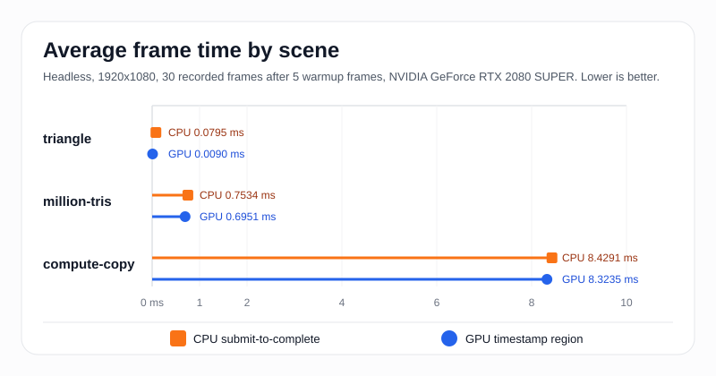
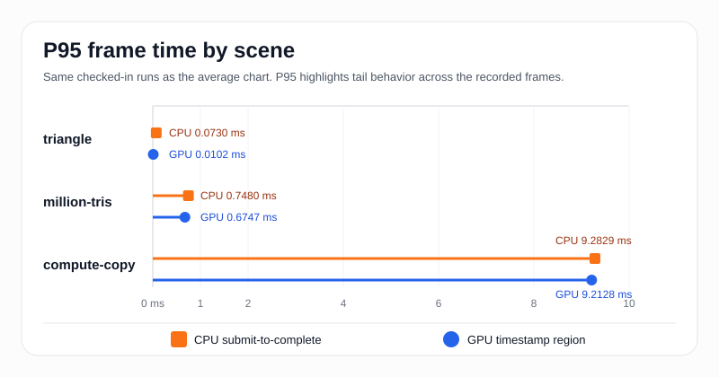

Isolating a GPU performance change becomes difficult when a renderer is also streaming assets, managing materials, and running background work.

`vk-bench` keeps the workload small: one executable, a few controlled scenes, and JSON results that can be compared by hand or in CI. It records CPU submit-to-complete time alongside GPU timestamps so changes can be traced to a specific draw or dispatch.

Repository: [semihguresci/vk-profiling-benchmark](https://github.com/semihguresci/vk-profiling-benchmark)

## Benchmark design

The benchmark keeps a consistent measurement setup:

- It runs one workload per frame and keeps the output format stable.
- It records both CPU submit-to-complete time and GPU timestamp time.
- It supports a reproducible Linux Docker path with NVIDIA GPU access as the default workflow.

This makes it easier to investigate a regression without changes elsewhere in a renderer affecting the result.

## Workloads and timing

The executable has three scenes:

- `triangle`: minimal graphics path with one triangle by default, or `--triangles N` for controlled scaling.
- `million-tris`: a raster-heavy draw of 1,000,000 triangle instances.
- `compute-copy`: a compute-only storage-buffer dispatch.

Each run uses the same timing model:

- GPU time comes from two Vulkan timestamps around the recorded workload.
- CPU time measures submit-to-complete per frame.
- Warmup frames are excluded from the final stats.

CPU time includes the full wait for the submitted frame to complete. GPU time measures the recorded workload between the two timestamps.

## Sample results

The repository already contains benchmark outputs in `results/`. The charts below use the checked-in sample runs for:

- `results/triangle.json`
- `results/million-tris.json`
- `results/compute-copy.json`

All three were captured headless at `1920x1080` on an `NVIDIA GeForce RTX 2080 SUPER`, with `5` warmup frames and `30` recorded frames.

| Scene | CPU avg (ms) | GPU avg (ms) | CPU p95 (ms) | GPU p95 (ms) |
| --- | ---: | ---: | ---: | ---: |
| `triangle` | 0.0795 | 0.0090 | 0.0730 | 0.0102 |
| `million-tris` | 0.7534 | 0.6951 | 0.7480 | 0.6747 |
| `compute-copy` | 8.4291 | 8.3235 | 9.2829 | 9.2128 |

These values are copied directly from the checked-in JSON outputs. In this codebase, `p95` is the sorted sample at `floor(0.95 * (n - 1))`, not an interpolated percentile, so with 30 recorded frames the average can end up slightly above `p95` if a small number of spikes pull the mean upward.



`triangle` averages `0.0090 ms` of GPU time in this run. It provides a quick check of the rendering path, shader lookup, screenshot capture, and headless execution.

`million-tris` stays below `1 ms` on both CPU and GPU in this sample. Its heavier raster workload provides a clearer signal when investigating shader, synchronization, or driver changes.

`compute-copy` has the longest GPU time in the sample set at `8.3235 ms`. The CPU submit-to-complete time is close at `8.4291 ms`, indicating that the dispatch and its completion account for most of the measured frame.

## Timing variability

The average and p95 together show how much the recorded frame times vary.



The `million-tris` run looks tight: the p95 values stay close to the averages on both CPU and GPU. `compute-copy` is also fairly compact, but the tail stretches to a bit above `9.2 ms`, which is large enough to watch if this scene becomes a primary regression target.

The `triangle` timings are small enough that scheduling effects can noticeably change the relationship between average and p95. This scene is most useful as a correctness and low-overhead check; the heavier workloads offer a clearer performance signal.

## Reproducing the runs

Run the scripted batch:

```bash
scripts/run_bench.sh results
```

Each run writes JSON with scene metadata plus `avg`, `p50`, and `p95` for CPU and GPU frame times. Graphics scenes also emit a screenshot bitmap next to the JSON output, which makes it easier to pair performance data with a visible correctness check.

## Next steps

Two improvements would make future comparisons easier:

- Store more benchmark history in `results/` or CI artifacts to make trend lines possible.
- Use the existing Nsight helper to connect frame-time deltas back to queue activity and synchronization.
