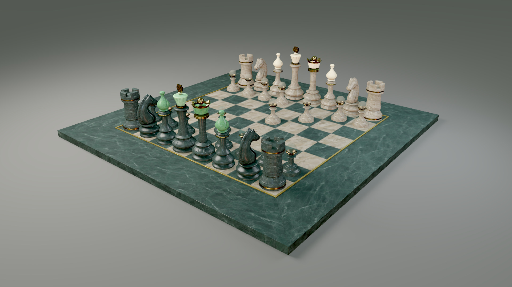
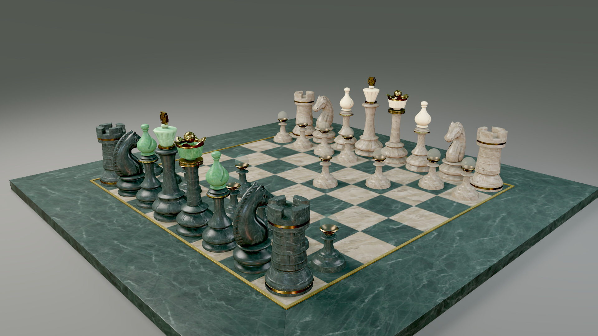
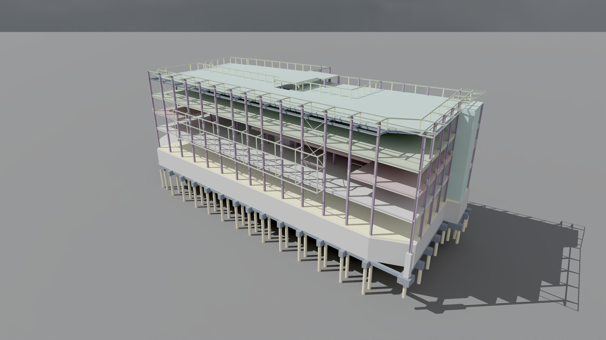
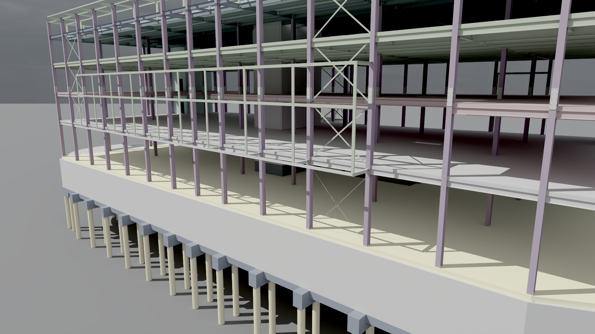
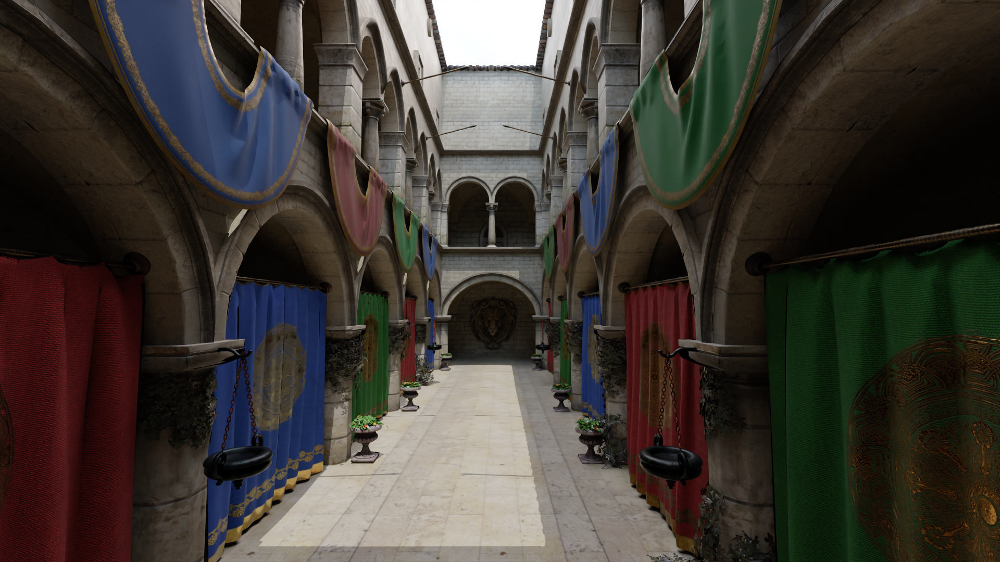
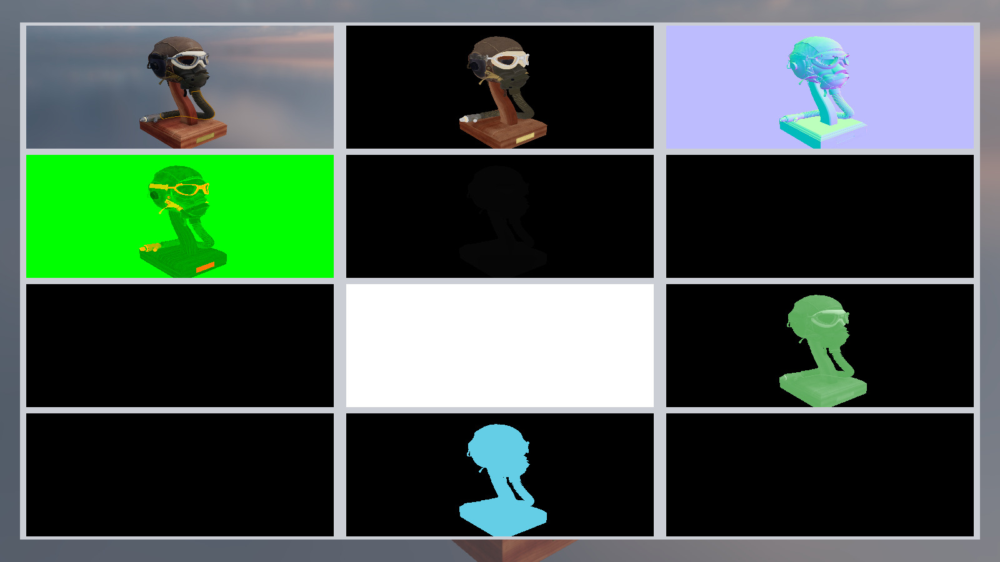

I’m building VulkanSceneRenderer to explore real-time graphics in C++23 and
Vulkan 1.4. It supports forward and deferred rendering, GPU-driven visibility,
layered physically based materials, and scenes ranging from glTF assets to
BIM buildings and USD meshes.

I want to understand how each frame is produced and where its time goes. The
project combines rendering with scene inspection, debug views, and GPU
profiling. This article covers the current source; some features are newer
than the downloadable TAA preview.

## Forward and deferred rendering

You can switch between forward and deferred rendering while keeping the same
scenes, materials, lights, and editor controls. Both paths share environment
lighting, culling, and telemetry.

The core targets Vulkan 1.4 with dynamic rendering and synchronization.
Vulkan-Hpp RAII manages Vulkan object lifetime, VMA manages GPU allocations,
and Slang compiles shaders to SPIR-V 1.6. Bindless descriptors, buffer device
addresses, indirect draws, and indirect draw counts support the rendering paths.

GPU compute passes cull objects outside the camera and use hierarchical depth
to reject hidden geometry. Supported opaque draws then use indirect commands
generated on the GPU. BIM scenes have a separate visibility and draw-compaction
path. Transparent surfaces, double-sided geometry, and diagnostic draws keep
their own draw paths.

A simplified view of the raster frame is:

```text
Scene providers: glTF / BIM / USD
  -> GPU visibility + depth + Hi-Z
  -> Forward raster OR deferred G-buffer + lighting
  -> Transparency / OIT
  -> Native HDR temporal resolve, when enabled
  -> Exposure + bloom + display conversion
  -> Scene inspection, overlays, and UI
```

`RendererFrontend` manages renderer lifetime and frame submission.
`FrameRecorder` records the passes in render-graph order. Separate managers
handle scenes, lighting, shadows, visibility, temporal rendering, and
post-processing, along with the resources each system needs.

## Materials, lighting, and temporal rendering

The glTF material system covers metallic-roughness PBR, normal and emissive
maps, alpha masks, specular, clearcoat, sheen, transmission and volume,
iridescence, and dispersion. Refraction and some layered effects remain
approximations.





These native 1920 × 1080 views use forward PBR with TAA, two rectangular
studio lights and an added matte receiver. The original 49 instances,
15 materials and 2048 × 2048 textures are retained. The scene's solid glass
produces unsupported paths in the current reference tracer, so these views
use the forward renderer.

Lighting combines HDR image-based lighting, cascaded directional and local
shadow maps, tiled light culling, and GTAO for ambient occlusion. Rectangular
and disk lights use linearly transformed cosine (LTC) integration. When the
lookup tables or material conditions do not support it, they use sampled
lighting.

Both rendering paths support native-resolution HDR temporal anti-aliasing
(TAA). It uses signed motion, surface identity, depth, and reactive masks to
decide when previous frames can contribute. Only successfully submitted frames
become history. TAA is optional and currently works at 1× samples; MSAA is a
separate option in both paths. Transparent regions and surfaces without
reliable history use the current frame.

## Beyond glTF: BIM and USD inspection

Alongside a primary glTF/GLB scene, the viewer loads `.bim`, STEP IFC, IFCX,
and USD/USDA/USDC/USDZ mesh files. BIM geometry and metadata stay in a dedicated
provider, separate from the primary glTF buffers.

Native IFC import handles a growing set of representations. When an import is
partial, it reports the affected source entities and products. USD mesh
loading uses TinyUSDZ. Both import paths have documented coverage limits.





Both views load the native STEP IFC source and use 512 samples per pixel,
eight path-tracing bounces, OptiX display denoising and AgX. The import reports
10,042 of 10,042 represented products, with no skipped or incomplete
representations. The supplied model is structural; its simplified materials
and absence of furniture reflect that source. An analytic receiver sits below
the foundations, without changing the building geometry.

You can select and move objects in the viewport, browse the scene hierarchy,
and search BIM elements to inspect their properties and relationships. Filters,
section cuts, and measurement tools help inspect larger models. Models are
decoded in the background before the render thread installs their GPU
resources. A failed load leaves the current scene open.

The current source also includes optional CPU rigid-body physics through Jolt.
You can attach box colliders to scene meshes or BIM/USD products, then play,
pause, step, or reset the simulation. Fixed, hinge, and slider joints support
simple connected mechanisms, with limits and motors for hinges and sliders.
The tools focus on these rigid-body interactions.

## Ray queries and experimental diffuse GI

Two optional lighting features share acceleration structures built from glTF,
BIM, and USD geometry.

**Ray-query shadows** trace the scene geometry to check whether lights are
blocked. Directional and local lights support hard shadows; rectangular and
disk emitters can produce sampled soft shadows.

**Experimental dynamic diffuse global illumination (DDGI)** estimates indirect
lighting using probes and a bounded ray budget. It stores irradiance and
visibility in atlases, with controls for scene fitting, probe classification,
and relocation. Probe volumes can blend together and follow the camera.

Both require ray-query-capable hardware. Raster shadows are the default and
fallback. DDGI is off by default and still under development. These features
extend the raster pipelines. Gaussian splatting and radiance-field rendering
are not implemented.

## Reference path tracing

The current source also includes progressive reference path tracing on
supported ray-query hardware, with sample diagnostics, scene-linear EXR output
and optional display denoising. The Sponza views use 512 samples per pixel,
eight bounces and OptiX display denoising, followed by a native AgX display
grade. Each camera starts a separate accumulation history.



This is a reference rendering path with documented material and transport
limits. In particular, the chess scene above uses forward rendering because
its solid-glass paths are unsupported. The
[reference path-tracing guide](https://github.com/semihguresci/VulkanSceneRenderer/blob/735bedbb3ef82429565ae27bde4657af8dfa1822/docs/reference-path-tracing.md)
records those limits and the available denoising backends.

## Debugging and profiling

Material, normal, depth, shadow, transparency, temporal, and intermediate-target
views help trace rendering problems back to the data and pass responsible.



Historical diagnostic capture from 4 October 2026: deferred raster, TAA,
1× MSAA at 1600 × 900. Flight Helmet is by Gary Hsu, CC0.

The telemetry panel shows CPU phase timings and GPU pass timings alongside
render-graph state, culling and light counters, synchronization, and resource
capacity. GPU timing uses performance queries when supported and falls back
to timestamp queries. Deterministic captures save telemetry in accompanying
files so runs can be compared.

The repository includes CPU tests and opt-in GPU validation for rendering
conventions, temporal history, model loading, lighting, and scene behavior.
Recorded quality and performance results apply to the listed scenes, devices,
and settings.

## Build and explore

Windows and Linux source-build presets are provided. On Windows, use a Visual
Studio Developer Command Prompt with a C++23 compiler, the Vulkan 1.4 SDK, and
`VCPKG_ROOT` configured:

```powershell
cmake --preset windows-release
cmake --build out/build/windows-release --target VulkanSceneRenderer --config Release
ctest --test-dir out/build/windows-release --output-on-failure
```

Run the two raster techniques from the built runtime directory:

```powershell
.\VulkanSceneRenderer.exe --render-technique deferred-raster --taa --msaa 1
.\VulkanSceneRenderer.exe --render-technique forward-raster --msaa 4
```

Use a current source build for ray-query shadows, DDGI, and physics. The
published `v0.2.0-taa-preview` is an earlier snapshot and does not include all
of the features described here.

[Explore VulkanSceneRenderer on GitHub](https://github.com/semihguresci/VulkanSceneRenderer)

## Capture notes and credits

The six new beauty renders were captured directly by VulkanSceneRenderer on
7 November 2026 at 1920 × 1080, on an NVIDIA GeForce RTX 2080 SUPER. Sponza
and Tekla use 512 samples per pixel, eight bounces and OptiX display denoising;
A Beautiful Game uses forward PBR, TAA and two area lights. All six use native
AgX grading. The source JPEGs were copied unchanged from the renderer's gallery;
there is no cropping, retouching, generated content or image relighting.
The Flight Helmet diagnostic image above remains an explicitly historical
October capture.

Sponza is © 2016 Crytek, with the improved model by Frank Meinl, based on
Marko Dabrovic's original, and PBR textures by Alexandre Pestana. Its model
and textures use the Cryengine Limited License Agreement. A Beautiful Game
is by Moeen Sayed and Mujtaba Sayed for SideFX, © 2020 ASWF/MaterialX Project;
the glTF conversion is © 2022 Ed Mackey, with initial geometry conversion by
Chris Rydalch and Jonathan Stone, under CC-BY-4.0. Its gallery variant adds
one 100 m matte receiver and two studio lights; the original model's geometry,
materials, transforms and 2K textures are unchanged. Tekla House comes from
buildingSMART's preliminary IFC 5 education/testing examples. Its original
building model is unchanged; the ground receiver and grade are viewer settings.

The environments are Poly Haven's CC0 Citrus Orchard Road (Pure Sky), by
Dimitrios Savva and Jarod Guest, and Aerodynamics Workshop, by Oliksiy
Yakovlyev. Full source licenses, change notices and reproducible camera,
lighting, grading and capture settings are pinned to renderer revision
`735bedbb3ef82429565ae27bde4657af8dfa1822`:

- [Asset attribution and usage notes](https://github.com/semihguresci/VulkanSceneRenderer/blob/735bedbb3ef82429565ae27bde4657af8dfa1822/docs/images/readme/README.md)
- [Per-image capture settings and hashes](https://github.com/semihguresci/VulkanSceneRenderer/blob/735bedbb3ef82429565ae27bde4657af8dfa1822/docs/images/readme/capture-settings.json)
- [Chess scene attribution and change notice](https://github.com/semihguresci/VulkanSceneRenderer/blob/735bedbb3ef82429565ae27bde4657af8dfa1822/docs/images/readme/scenes/ABeautifulGame-studio-NOTICE.txt)

The captures used local source builds before the merge; the recorded executable,
shader and input hashes identify those builds more precisely than a Git commit.
The published `v0.2.0-taa-preview` remains an older release and does not contain
all the features or captures shown here.
