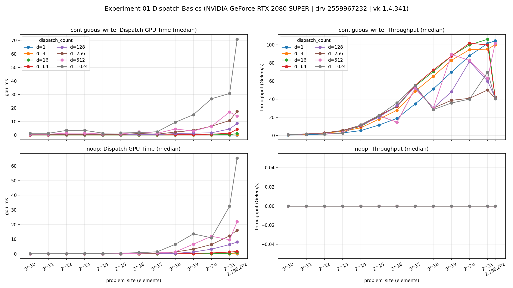
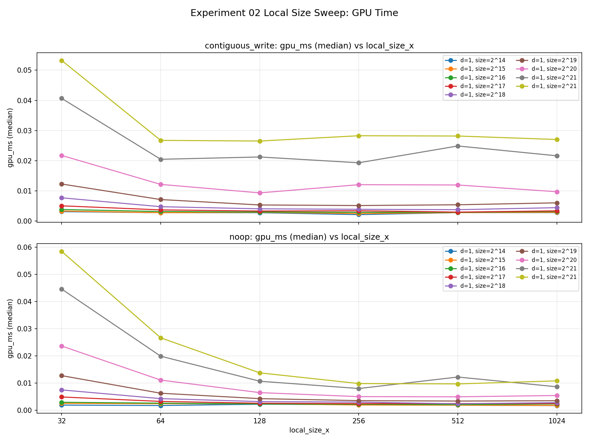

**Part 1 of 9.** [Series overview](/blog/gpu-memory-experiments-series/) · [Previous: introduction](/blog/gpu-memory-experiments-series/) · [Next: layouts and precision](/blog/gpu-memory-experiments-06-10-layout-padding-and-precision/)

Before asking whether a memory layout is fast, I want to know what my benchmark is counting. An empty dispatch still consumes time. A copy moves two useful streams. Repeating a write requires synchronization. A result can look convincing while its byte count describes work the shader never performed.

These first five experiments establish the vocabulary for the rest of the series. I am using the corrected October 23 collection, measurement revision `2026-10-23-integrity-fixes`: an NVIDIA GeForce RTX 2080 SUPER, driver 610.88, Vulkan 1.4.341, two warmups, and five timed iterations per case. The total scratch budget is 32 MiB. Buffer capacity is smaller because the budget includes simultaneously live resources.

Every number below is a median recomputed from the five matching raw rows. Problem size and dispatch count remain separate grouping keys. This is one exploratory collection on one GPU, without validation layers enabled during timing; it is a starting point for investigation, not a portable hardware specification.

## 01: An empty dispatch is a useful control

Experiment 01 compares an empty shader with a contiguous float write. The write produces `output[i] = float(i)` and checks every logical output after readback. The no-op check confirms that the initialized buffer remains unchanged. Sizes and repetitions vary, while the write kernel uses 64 invocations per workgroup.

At **2,796,202 elements**, the measured GPU intervals were:

| Variant | Dispatches | Median GPU ms | Useful GB/s |
|---|---:|---:|---:|
| Contiguous write | 1 | 0.026784 | 417.593 |
| No-op | 1 | 0.026304 | 0 |
| Contiguous write | 4 | 0.111872 | 399.914 |
| No-op | 4 | 0.105888 | 0 |

The near-equal single-dispatch times are interesting precisely because the shaders do different useful work. At this size, elapsed time alone is a weak indicator of bytes processed. I do not give the no-op an elements-per-second score: launching an invocation does not make it a useful memory operation.

The corrected write passes its logical count explicitly and guards the rounded-up tail. It also inserts compute write dependencies between repeated dispatches. Their cost is inside the reported interval. That makes repetition legal, but it means the curve includes synchronization as well as dispatch and storage work. The larger repetition cases are visibly irregular; I would not infer a universal batching rule from them.

[Download experiment 01 raw rows](/assets/blog/gpu-memory-experiments-2026-10-23/data/01_dispatch_basics.json).

## 02: Workgroup size changes the execution context

Experiment 02 keeps the same contiguous write and its complete output oracle, then sweeps local sizes from 32 to 1,024. The adapter requests one dispatch, so this comparison does not mix different repetition counts. Unsupported launch sizes are excluded using device limits.

At **2,796,202 elements and one dispatch**, the write medians were:

| Local size | Median GPU ms |
|---:|---:|
| 32 | 0.053248 |
| 64 | 0.026752 |
| 128 | 0.026528 |
| 256 | 0.028288 |
| 512 | 0.028192 |
| 1,024 | 0.027040 |

The 32-invocation case stands apart; the other five are much closer. I read that as a reason to test launch geometry before attributing a later difference to data layout. I do not read the narrow lead of 128 as a general recommendation. Five samples from this kernel cannot establish that it wins across devices, register footprints, or working sets.

Changing workgroup size changes how the same logical work is partitioned. Scheduling and resource use can move together. The experiment observes their combined effect; it does not measure occupancy directly or explain which scheduling mechanism produced the result.

[Download experiment 02 raw rows](/assets/blog/gpu-memory-experiments-2026-10-23/data/02_local_size_sweep.json).

## 03: A bandwidth numerator needs an operation

Experiment 03 provides three device-local controls: read a source, write a destination, or copy between them. All use a 256-invocation workgroup. Upload and readback are separate stages from the dispatch interval quoted here.

At **2,796,202 elements and one dispatch**, read-only took **0.031744 ms**, write-only **0.027328 ms**, and read/write copy **0.053312 ms**. Their useful-payload rates were **352.344**, **409.280**, and **419.598 GB/s**, respectively.

The copy's greater GB/s does not mean that its dispatch finished sooner. Its numerator counts an input float and an output float, eight bytes per element, while each single-direction mode counts four. I keep that distinction visible because it is easy to mistake a metric change for an execution improvement.

Writes and copies have full output checks against deterministic patterns. The read-only shader issues volatile loads, but the returned correctness evidence consists of four probes. That narrower oracle is a real limitation: checking four values is not equivalent to validating an entire transformed output.

This gives me a useful reference for later kernels. It still does not reveal physical DRAM transactions, cache hit rates, or the cost of moving application data to the GPU.

[Download experiment 03 raw rows](/assets/blog/gpu-memory-experiments-2026-10-23/data/03_memory_copy_baseline.json).

## 04: Start with the address expression I can explain

Experiment 04 maps each global invocation directly to the corresponding source and destination element. Its small transform adds `i & 7` to a deterministic input. The host checks every output, and the logical input/output pair contributes eight useful bytes per element per dispatch.

At **2,796,202 elements**, one dispatch took **0.053248 ms**, or **420.102 GB/s**. Four dispatches took **0.209696 ms**, or **426.706 GB/s**. The latter rate counts four complete transforms and includes the three dependencies between their writes.

I use this as the ordinary path against which more elaborate indexing must justify itself. It keeps addresses predictable and useful work small enough that address-generation overhead can matter. The repeated cases may also reuse cached data, however, so they are not interchangeable with a stream that visits fresh resources on every dispatch.

Correct output establishes the transform's result for each measured case. It does not establish a cache mechanism, and the repeated identical writes do not provide a separate per-dispatch output history.

[Download experiment 04 raw rows](/assets/blog/gpu-memory-experiments-2026-10-23/data/04_sequential_indexing.json).

## 05: Flexible indexing can be affordable

Experiment 05 preserves that transform and its complete logical output, while changing the mapping: direct indexing, a wraparound offset of 17 elements, or a grid-stride loop. The grid-stride case launches fewer invocations and lets each visit multiple elements.

For **2,796,202 elements and one dispatch**, direct indexing took **0.053024 ms**, offset indexing **0.052928 ms**, and grid-stride indexing **0.052000 ms**. At four dispatches, the medians were **0.209536**, **0.209920**, and **0.209152 ms**. Useful byte accounting remains identical across the mappings.

Those close results make flexible indexing look inexpensive in this particular workload. They do not prove that the loop is free. Direct and offset modes launched 10,923 workgroups; grid-stride launched 2,730. That changes scheduling alongside control flow. The useful engineering question is whether the implemented mapping suits a workload, not whether one source expression is universally cheapest.

[Download experiment 05 raw rows](/assets/blog/gpu-memory-experiments-2026-10-23/data/05_global_id_mapping_variants.json).

## Carrying a trustworthy baseline forward

My rule for the next experiments is to keep the work, address space, oracle, and byte formula beside the timing. Vulkan's [synchronization chapter](https://docs.vulkan.org/spec/latest/chapters/synchronization.html) supplies the dependency rules; the measurements tell me what these implementations cost on this device.

The [public benchmark repository](https://github.com/semihguresci/gpu-memory-access-benchmark) supplies project context. The corrected working tree was uncommitted when this collection was made, so I use the downloadable snapshots as the evidence rather than implying that repository `main` reproduces it. The [series summary CSV](/assets/blog/gpu-memory-experiments-2026-10-23/data/summary.csv) and [snapshot manifest](/assets/blog/gpu-memory-experiments-2026-10-23/data/manifest.json) make the numerical trail explicit.

[Continue to part 2: layout, padding, and precision](/blog/gpu-memory-experiments-06-10-layout-padding-and-precision/).
