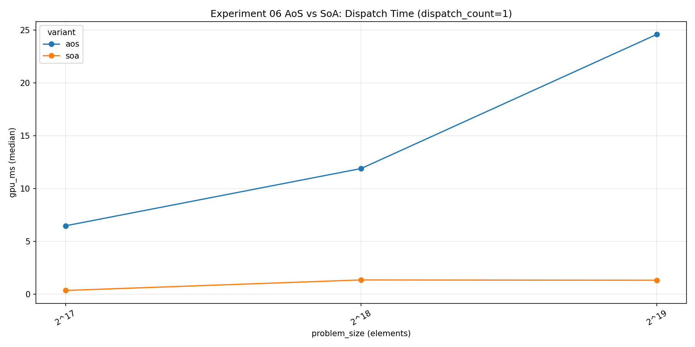
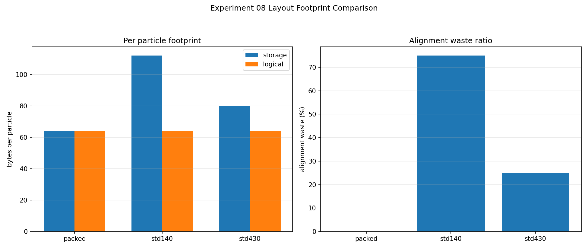
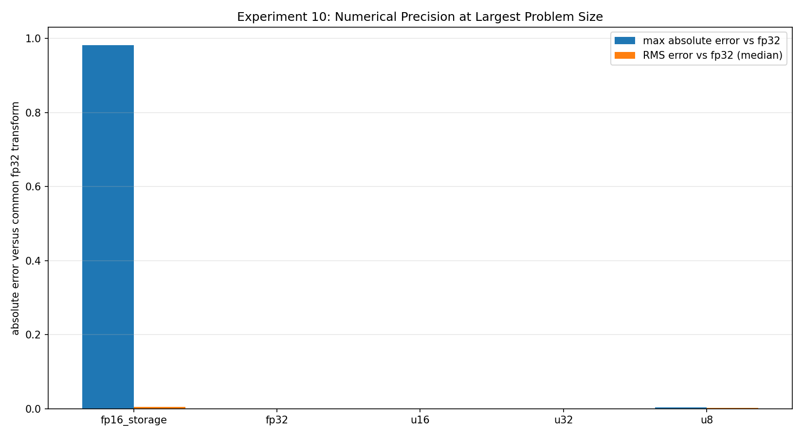

**Part 2 of 9.** [Series overview](/blog/gpu-memory-experiments-series/) · [Previous: dispatch and measurement](/blog/gpu-memory-experiments-01-05-dispatch-and-measurement/) · [Next: access patterns and reuse](/blog/gpu-memory-experiments-11-15-access-patterns-and-reuse/)

A smaller record is an attractive optimization because I can see the saved bytes before running anything. The harder question is whether neighboring invocations request those bytes in a useful arrangement, and whether changing the representation preserves the values I meant to compute.

These five experiments separate several versions of that question. The evidence is the corrected October 23 collection, revision `2026-10-23-integrity-fixes`: RTX 2080 SUPER, driver 610.88, Vulkan 1.4.341, 32 MiB total scratch, two warmups, and five timed iterations per case. Every timing below is the median of matching raw rows at **one dispatch**. Different experiments have different logical problem sizes and should not be ranked against each other.

There is also a known defect in the frozen fp16 conversion path, diagnosed while preparing this article. I keep that counterexample visible rather than turning its passing oracle into a precision recommendation.

## 06: Match the field operations before comparing layouts

Experiment 06 updates particle position using velocity and a time step, then increments mass. AoS places each particle's fields together; SoA places corresponding fields from many particles together. Both implementations now request **eight scalar reads and four scalar writes** per particle. The complete host oracle checks updated and unchanged fields after every measured run.

At **524,288 particles**, AoS took **24.608000 ms** and SoA **1.334016 ms**. Their useful-payload rates were **1.023** and **18.865 GB/s**. The common numerator is **48 bytes per particle**, so this comparison does not award one layout a larger byte count for the same update.

That is a substantial observed difference, but placement matters. The exported first-buffer metadata reports memory type 3, heap 1, property flags 6: host-visible and host-coherent. I cannot quietly describe this as a comparison of streaming through device-local VRAM. The metadata is explicitly scoped to the first storage buffer, rather than an assertion about every allocation.

My practical conclusion is to organize a frequently updated field stream deliberately. The experiment does not tell me the exact number of physical transactions, nor whether a different allocation policy would preserve this ratio.

[Download experiment 06 raw rows](/assets/blog/gpu-memory-experiments-2026-10-23/data/06_aos_vs_soa.json).

## 07: Blocking is another choice, not a guaranteed compromise

Experiment 07 adds auxiliary and cold fields, then compares AoS, SoA, and AoSoA blocks of 4, 8, 16, and 32 particles. The useful transform remains the same across layouts: **12 scalar reads, eight scalar writes**, or **80 useful bytes per particle**. The host validates all fields, including cold fields that should remain unchanged.

At **174,752 particles**, AoS took **5.641120 ms**, SoA **0.835872 ms**, and AoSoA with 16 particles per block **1.224928 ms**. The other block widths took **3.571776 ms** for 4, **2.720800 ms** for 8, and **1.536480 ms** for 32.

The best tested block was therefore 16, while SoA was still faster in this collection. I would choose a block width by considering which consumers need whole particles and which need fields across particles, then measuring the actual access pattern. There is no reason to assume that the largest block wins.

This is also a small sweep under a total scratch constraint. Declared blocking changes address arithmetic and field arrangement together. Source-level matching removes the previous extra-field traffic confound; it does not turn the result into a direct cache-line or occupancy measurement.

[Download experiment 07 raw rows](/assets/blog/gpu-memory-experiments-2026-10-23/data/07_aosoa_blocked_layout.json).

## 08: Footprint and runtime are different axes

Experiment 08 holds a logical record and its update constant while representing it with `std140`, `std430`, or manual packing. The record contains 64 bytes of logical fields; implemented storage strides are **112**, **80**, and **64 bytes**, respectively. CPU layout checks and per-iteration value validation keep the host/shader interpretation explicit.

At **131,072 records**, `std430` took **8.109792 ms**, `std140` **10.379680 ms**, and the manually packed form **11.135808 ms**. The smallest representation was not the fastest here.

That is exactly the distinction I want this experiment to expose. A compact format can reduce allocation footprint while changing indexing, loads, stores, and generated instructions. The measured logical bandwidth counts a read and write of the useful fields; it is not obtained by treating all padding bytes as useful payload.

The [Vulkan Guide's memory-layout chapter](https://docs.vulkan.org/guide/latest/shader_memory_layout.html) explains the alignment families and feature-dependent alternatives. These particular records do not cover every scalar-layout possibility. I would not generalize their stride or ranking to every structure that happens to use the same layout qualifier.

[Download experiment 08 raw rows](/assets/blog/gpu-memory-experiments-2026-10-23/data/08_std430_std140_packed.json).

## 09: A vec3 comparison can also be an organization comparison

Experiment 09 uses 11 logical floats per particle and compares a 64-byte padded vec3 record, a 48-byte vec4 grouping, and 44 bytes of split scalar arrays. All variants perform the same logical update and validate the complete result against the host reference.

At **215,092 particles**, padded vec3 took **10.921472 ms**, vec4 **6.482400 ms**, and split scalars **1.210816 ms**. Their logical read/write payload is held at **88 bytes per particle** for the bandwidth calculation.

I find the direction useful, but calling the entire difference a “vec3 penalty” would hide too much. Record footprint changes, field grouping changes, and the split layout changes how neighboring invocations encounter neighboring fields. The experiment bundles those choices.

For an application, I would first write down the required binary interface and hot-field access pattern. I would then test representations satisfying that interface, including equal-footprint controls where possible. A vector type's name alone is not a memory-performance explanation.

[Download experiment 09 raw rows](/assets/blog/gpu-memory-experiments-2026-10-23/data/09_vec3_vec4_padding_costs.json).

## 10: Correct transport and useful precision need different oracles

Experiment 10 applies a bounded scalar transform to **2,581,110 logical values**. It compares fp32 storage, float bits carried in `u32`, and manually packed normalized `u16` and `u8` values. These are transport and conversion implementations, not a study of native narrow arithmetic. Packed words also let one invocation process multiple logical values.

| Representation | Median GPU ms | Maximum error versus common fp32 reference |
|---|---:|---:|
| fp32 | 2.200544 | 0.000000 |
| u32 float-bit transport | 2.219296 | 0.000000 |
| Packed normalized u16 | 0.473792 | 0.000015 |
| Packed normalized u8 | 0.236832 | 0.003879 |

Preparation and CPU validation are outside those GPU intervals. A representation-specific oracle checks whether each implementation produced its intended quantized result. A separate common fp32 oracle measures numerical loss. For example, u8's format residual was exported as zero, while its common-reference RMS error was **0.001587**. Those statements are compatible because they answer different questions.

The frozen `fp16_storage` path is a diagnosed counterexample. Its format residual was only **0.000488**, yet maximum error against the common reference reached **0.981464**, with RMS **0.005366**. The host packer compares a signed adjusted exponent with unsigned `0x1FU`; negative exponents take the overflow branch. An independent boundary check shows zero and half-subnormal inputs becoming infinity. The GPU then receives incorrectly packed data, and the format oracle shares that packing mistake.

The [CPU reproduction](/assets/blog/gpu-memory-experiments-2026-10-23/data/reproduce_fp16_packing.py) and [its output](/assets/blog/gpu-memory-experiments-2026-10-23/data/reproduce_fp16_packing.txt) document that specific zero/subnormal defect. They do not certify every rounding boundary. I exclude this fp16 path from valid precision and performance recommendations; its large error is not an intrinsic property of fp16.

[Download experiment 10 frozen raw rows](/assets/blog/gpu-memory-experiments-2026-10-23/data/10_scalar_type_width_sweep.json).

## Keep the representation contract beside the timing

The [summary CSV](/assets/blog/gpu-memory-experiments-2026-10-23/data/summary.csv) and [evidence manifest](/assets/blog/gpu-memory-experiments-2026-10-23/data/manifest.json) accompany these snapshots and identify their limitations. The [public benchmark repository](https://github.com/semihguresci/gpu-memory-access-benchmark) provides context; the measured corrected working tree was uncommitted, so repository `main` is not the evidence for these exact values.

The next question is how addresses change when data stops arriving consecutively. [Part 3 follows stride, gather, scatter, and reuse](/blog/gpu-memory-experiments-11-15-access-patterns-and-reuse/).
