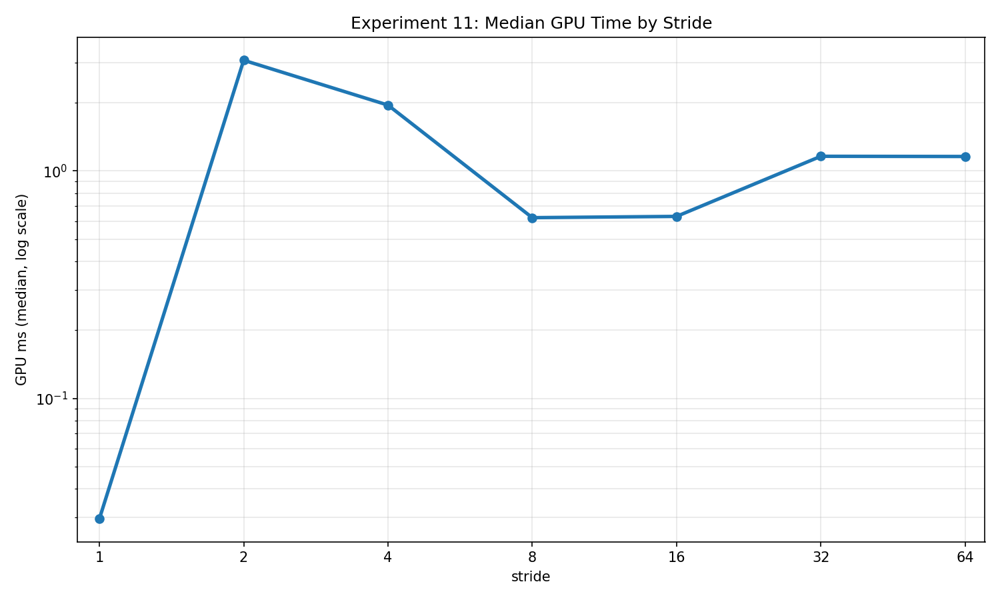
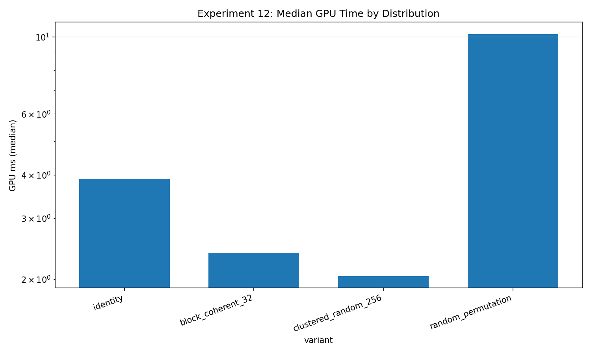
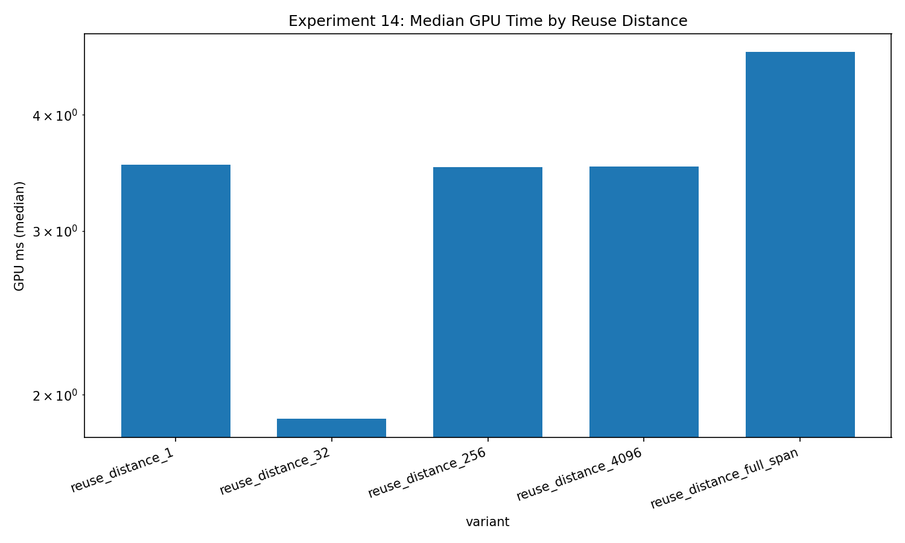

**Part 3 of 9.** [Series overview](/blog/gpu-memory-experiments-series/) · [Previous: layouts and precision](/blog/gpu-memory-experiments-06-10-layout-padding-and-precision/) · [Next: tiling, registers, and barriers](/blog/gpu-memory-experiments-16-20-tiling-registers-and-barriers/)

Two shaders can request the same number of useful bytes and ask the memory system very different questions. One reads neighboring addresses, another follows an index stream, and another makes neighboring invocations update the same counter. Counting bytes gives me a bandwidth numerator. Describing addresses tells me what the experiment is actually testing.

For experiments 11–15, I use the corrected October 23 snapshots: revision `2026-10-23-integrity-fixes`, RTX 2080 SUPER, driver 610.88, Vulkan 1.4.341, two warmups and five timed samples per case, with a 32 MiB total scratch budget. Every quoted comparison below uses **one dispatch**. Medians are recomputed within each exact variant, problem-size, and dispatch-count group.

The results contain a few awkward orderings. I keep them because they are useful reminders that a plausible memory story is not the same thing as evidence for its mechanism.

## 11: Stride changes more than adjacency

Experiment 11 reads a 32-bit value, adds one, and writes it back to the corresponding destination location. It varies the address stride while holding useful work at **65,536 logical elements**:

```cpp
physical_index = logical_index * stride;
destination[physical_index] = source[physical_index] + 1;
```

The host checks the output pattern, including the sentinel values in untouched locations. Each logical update contributes eight useful bytes to GB/s, regardless of the gaps between addresses.

Stride 1 took **0.029568 ms**, or **17.732 useful GB/s**. Stride 64 took **1.158080 ms**, or **0.453 GB/s**. But the middle of the curve is not monotonic: stride 2 took **3.067360 ms**, whereas stride 16 took **0.631392 ms**. I would not draw a cache-capacity boundary through those points without repeated independent collections and a stronger control.

There is also a deliberate confound to keep visible. Each buffer's physical span grows from **262,144 bytes** at stride 1 to **16,777,216 bytes** at stride 64. Both read and write addresses change. The experiment therefore combines access spacing, working-set span, and any associated transaction or residency effects. It establishes a substantial implementation difference, not an isolated transaction-size measurement.



[Download experiment 11 raw rows](/assets/blog/gpu-memory-experiments-2026-10-23/data/11_coalesced_vs_strided.json).

## 12: Gather needs an index-stream budget

Experiment 12 moves the irregularity into a separate index buffer. Every invocation loads an index, reads its selected source value, and writes a contiguous output containing that value plus one. The CPU checks every index and output against the generated reference.

The four current patterns are permutations: identity; shuffled blocks with 32 consecutive addresses inside each block; shuffled 256-element clusters with randomized addresses inside them; and a fully random permutation. They visit the same source elements once, while changing the relationship between invocation order and address order.

At **2,796,202 logical elements**, the medians were:

| Gather pattern | Median GPU ms | Useful GB/s |
|---|---:|---:|
| Identity | 3.893408 | 8.618 |
| Block coherent, 32 | 2.385664 | 14.065 |
| Clustered random, 256 | 2.045152 | 16.407 |
| Random permutation | 10.189376 | 3.293 |

The fully random case was slowest, but identity was not fastest. That prevents a tidy conclusion that increasing randomness always increases runtime. Block ordering and within-block coherence change together, and this collection does not include cache counters or randomized repeated run ordering.

The bandwidth numerator is **12 bytes per element**: index, source value, and destination value. The requested scratch budget is **33,554,432 bytes**; the three actual buffer payloads total **33,554,424 bytes**. I keep those quantities separate. Reporting one buffer's budget as the total would make the experiment harder to reproduce and the working set harder to interpret.



[Download experiment 12 raw rows](/assets/blog/gpu-memory-experiments-2026-10-23/data/12_gather_access_pattern.json).

## 13: Scatter has a contention topology

Experiment 13 performs one destination-counter atomic increment per invocation. A target-index stream selects either a unique permutation, a random distribution with four updates per active target, or locally concentrated updates into 32-target windows. The host builds the complete expected histogram and checks the full counter buffer after each measured run.

At **4,194,304 logical updates**, unique permutation took **43.885312 ms**. Random collisions took **44.716704 ms**, and the clustered-window case took **79.077536 ms**. These are three address distributions for the same atomic operation count, not an atomic-versus-plain-store comparison.

The clustered case is especially easy to describe incorrectly. It does not send the entire dispatch to one global group of 32 counters. Adjacent invocations concentrate on small windows, while the full run touches many targets. That local organization is part of the independent variable.

The exported 12-byte-per-update model counts a target-index read and an estimated read-modify-write payload. It is not a measurement of memory-bus traffic. Nor does a unique destination eliminate the cost of using an atomic instruction. My practical takeaway is to describe where collisions occur, not merely how many destination elements exist.

[Download experiment 13 raw rows](/assets/blog/gpu-memory-experiments-2026-10-23/data/13_scatter_access_pattern.json).

## 14: Logical reuse distance is not elapsed time

Experiment 14 constructs an indexed read stream in which each source value is used twice. The source contains **1,677,721 unique elements**, producing **3,355,442 logical reads and outputs**. The kernel and complete integer output oracle stay constant; the index stream controls the separation between matching references.

The distance-1 case took **3.536832 ms**. Distance 32 took **1.883552 ms**, distance 256 **3.516576 ms**, distance 4,096 **3.520960 ms**, and full-span separation **4.671776 ms**. The distance-32 useful-payload rate was **21.377 GB/s**, versus **8.619 GB/s** for full-span separation.

That looks suggestive, but a GPU does not promise that invocation `i` executes immediately before `i + 1`. The distance is a property of the logical index sequence, not a stopwatch between two physical memory requests. Address coalescing and scheduling can therefore affect the result alongside temporal reuse.

I treat this as a controlled schedule-of-references experiment. To identify a cache mechanism more directly, I would add dependent chains, a fixed-footprint permutation control, controlled priming or eviction, and hardware counter evidence. A timing knee alone cannot supply those missing observations.



[Download experiment 14 raw rows](/assets/blog/gpu-memory-experiments-2026-10-23/data/14_read_reuse_cache_locality.json).

## 15: A plateau is a hypothesis to test

Experiment 15 returns to device-local read-only, write-only, and copy kernels, then sweeps buffer sizes. The purpose is to see how effective throughput changes as the work grows, rather than selecting one attractive point and calling it the GPU's bandwidth.

At the largest common size, **2,796,202 elements**, read-only took **0.031040 ms**, write-only **0.026272 ms**, and copy **0.051872 ms**. Their useful-payload rates were **360.335**, **425.731**, and **431.246 GB/s**. As in the baseline experiment, copying counts eight bytes per element while reading or writing counts four.

The largest individual buffer is **11,184,808 bytes**, approximately 10.67 MiB. The total 32 MiB budget also pays for other live resources. That is an important limit on any claim about a sustained large-memory plateau. I have not swept arbitrary residency states or demonstrated that the measured bytes came from external DRAM.

Writes and copies validate complete deterministic outputs; the read-only path exposes four validation probes. Upload, readback, and CPU validation are separate from the quoted dispatch timing. An application with frequent transfers can therefore have a very different end-to-end cost.

[Download experiment 15 raw rows](/assets/blog/gpu-memory-experiments-2026-10-23/data/15_bandwidth_saturation_sweep.json).

## The address description travels with the result

I find these experiments most useful when their awkward details survive into the discussion: physical span for stride, index traffic for gather, destination topology for scatter, logical scheduling for reuse, and residency uncertainty for bandwidth. Those details determine which optimization is worth trying next.

The [summary CSV](/assets/blog/gpu-memory-experiments-2026-10-23/data/summary.csv) and [snapshot manifest](/assets/blog/gpu-memory-experiments-2026-10-23/data/manifest.json) accompany the raw downloads. The [public source repository](https://github.com/semihguresci/gpu-memory-access-benchmark) provides implementation context; the corrected collection came from an uncommitted working tree, so the onsite snapshots are the evidence for these numbers.

[Part 4 examines tiling, live temporary state, divergence, and barriers](/blog/gpu-memory-experiments-16-20-tiling-registers-and-barriers/), where synchronization and useful work need the same attention as addresses.
