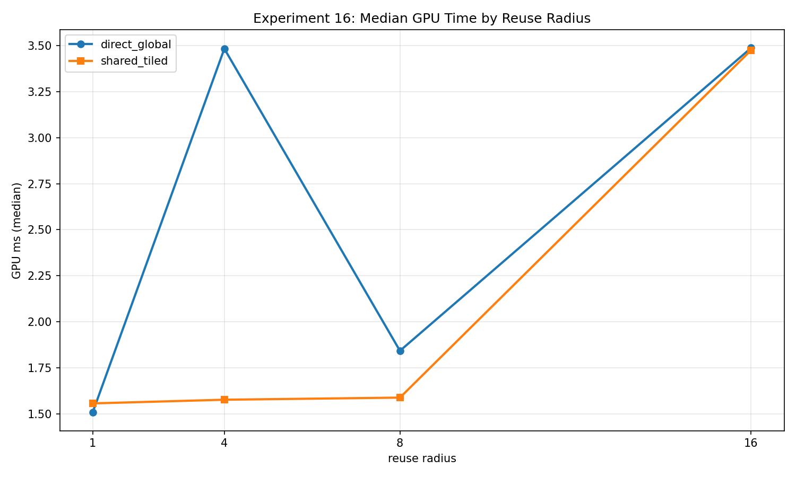
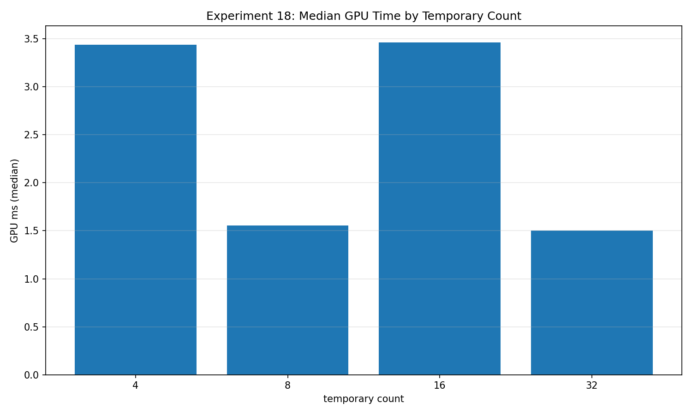
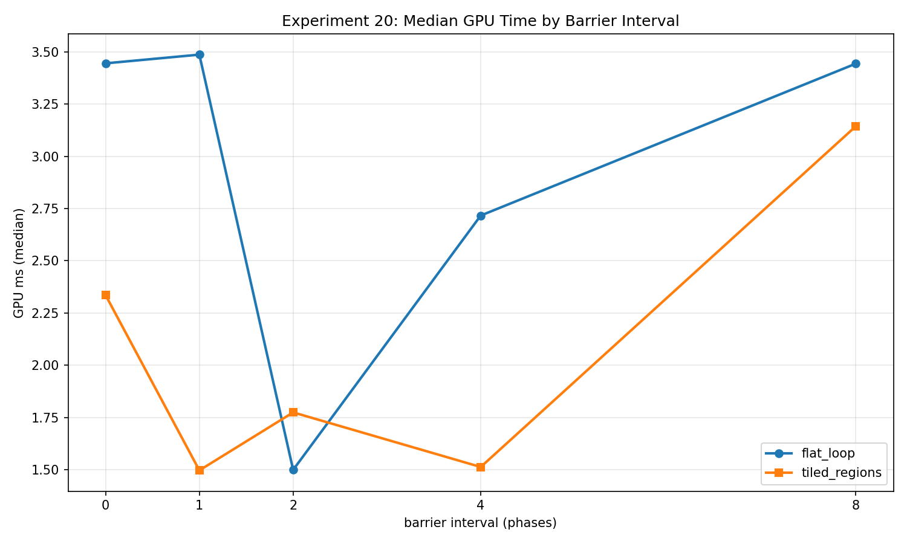

Once a kernel performs useful work, reducing its global loads is only one part of improving it. A tiled implementation needs cooperation. Cooperation needs synchronization. Holding more intermediate values can reduce dependencies while making the compiler's scheduling problem harder. I want these experiments to expose those tradeoffs without quietly changing the answer being computed.

This is part four of my [GPU memory experiment series](/blog/gpu-memory-experiments-series/). The measurements come from the corrected `2026-10-23-integrity-fixes` snapshot: an RTX 2080 SUPER, NVIDIA driver 610.88, Vulkan 1.4.341, two warmups, and five timed iterations per case. Each experiment here received a **32 MiB total scratch budget**. That budget is divided among resources; it is not the size of every buffer.

I recomputed the medians below from the exported rows. Every reported case passed its per-iteration correctness checks. Five samples on one GPU are exploratory evidence, especially where the ordering is surprising. They do not establish register counts, occupancy, cache misses, or a universal optimization rule.

## 16: when shared-memory reuse has something to repay

Experiment 16 computes a one-dimensional integer stencil. An output is the sum of its input neighborhood, with radius 1, 4, 8, or 16. The direct implementation loads the neighborhood from its source buffer. The tiled implementation cooperatively loads a workgroup-sized region plus its halo, executes one barrier, and reads that neighborhood from shared memory.

At a given radius, both paths produce the same outputs with the same additions. The local size stays at 256. The CPU oracle recomputes every output, and the harness also checks the deterministic source values. Across radii, the amount of useful arithmetic changes, so I compare implementations **within each radius** rather than treating radius as a free increase in reuse.

At `N=4,194,048` outputs and one dispatch:

| Radius | Direct median ms | Shared-tiled median ms |
|---|---:|---:|
| 1 | 1.507328 | 1.556416 |
| 4 | 3.482976 | 1.576416 |
| 8 | 1.842208 | 1.587840 |
| 16 | 3.487360 | 3.475168 |

The radius-four case gives me a reason to investigate staging; radius sixteen does not show a proportionally larger benefit in this collection. That matters because counting fewer source loads is not enough to predict elapsed time. Halo loads, shared reads, synchronization, compiler decisions, and the memory placement all participate.

The bandwidth numerator also differs: direct mode counts repeated requested neighborhood reads, while tiled mode counts its cooperative source loads. I use the times above for the matched-work comparison. A larger requested GB/s number does not establish more physical memory traffic.

[Experiment 16 raw rows](/assets/blog/gpu-memory-experiments-2026-10-23/data/16_shared_memory_tiling.json).

## 17: a tile-size sweep is also a workgroup-size sweep

Experiment 17 fixes the stencil radius at sixteen and varies tile width across 8, 16, 32, and 64. Each width has a direct and shared-tiled implementation. The shared path loads the tile plus a 32-element halo; a width-eight tile therefore pays much more halo overhead per output than a width-sixty-four tile.

The same full-output integer oracle checks every variant. The common problem size is bounded using the smallest tile's dispatch requirement, then rounded to a multiple that works for the entire sweep. This avoids selecting a legal size for the largest tile that over-dispatches a smaller one on devices with tighter limits.

At `N=4,194,240`, one dispatch, the direct medians for widths 8/16/32/64 were **7.854208 / 4.422688 / 3.123520 / 1.501280 ms**. The corresponding tiled medians were **5.525536 / 1.951520 / 1.481760 / 3.436832 ms**.

The change at width sixty-four is a useful warning against choosing a tile solely from halo efficiency. Tile width changes local workgroup size here, so it also changes launch shape and scheduling. This experiment cannot attribute that reversal to shared memory alone. In a renderer I would retain several legal tile choices and profile the actual kernel before making one the default.

[Experiment 17 raw rows](/assets/blog/gpu-memory-experiments-2026-10-23/data/17_tile_size_sweep.json).

## 18: fixed work with different live-state schedules

The corrected register-pressure proxy evaluates **32 independent integer chains per input**. Each chain is initialized once, updated for eight rounds, and folded into the result in the same order. Every variant therefore performs 256 state updates, reads one input word, and writes one output word.

What changes is the schedule: batches keep 4, 8, 16, or 32 chain states live together. The CPU reference evaluates chains individually and supplies one common expected output to all four variants. Increasing the temporary count no longer multiplies the useful computation or changes the transform.

At `N=4,194,304`, one dispatch:

| Live-state batch | Median GPU ms |
|---|---:|
| `temp_4` | 3.438048 |
| `temp_8` | 1.553856 |
| `temp_16` | 3.463104 |
| `temp_32` | 1.503648 |

This is clearly not a monotonic register-pressure curve. I describe it as sensitivity to a source-level schedule. The driver may scalarize arrays, reorder operations, change instruction overlap, or spill values. Batch width is an experimental control; actual register allocation is an unmeasured mechanism. Compiler resource reports and a profiler would be the next evidence I would collect before discussing occupancy.

[Experiment 18 raw rows](/assets/blog/gpu-memory-experiments-2026-10-23/data/18_register_pressure_proxy.json).

## 19: predicate patterns need their own controls

Experiment 19 selects between two six-round integer mixing paths. They have the same source-level operation structure but different salts. The predicate is uniformly true, uniformly false, alternating by index, or generated from a deterministic hash with approximately 25%, 50%, or 75% true outcomes.

At `N=4,194,304`, one dispatch, `uniform_false` measured **1.496448 ms**, `uniform_true` **3.436256 ms**, `alternating` **3.431648 ms**, and `random_p50` **2.695520 ms**. A CPU implementation checks the predicate and exact transform for every output after each measured run.

I would not turn these numbers into a general statement that random branches are cheaper than alternating ones. Random modes additionally evaluate a hash, the two salts differ, and the generated machine code may use predication or otherwise transform the selection. The experiment records behavior of these programs. It does not directly count divergent branch instructions. A more isolated follow-up would hold predicate generation cost and true fraction fixed while changing only spatial coherence.

[Experiment 19 raw rows](/assets/blog/gpu-memory-experiments-2026-10-23/data/19_branch_divergence.json).

## 20: measure additional barriers around identical work

Experiment 20 now publishes one immutable shared seed per workgroup. One mandatory barrier makes publication complete before consumers use it. Every invocation then performs the same eight arithmetic phases and seed reads, regardless of the selected interval. Flat and tiled loop forms produce exactly the same output, checked against one CPU reference on every timed iteration.

`b0` means no **additional** barriers. Intervals `b1`, `b2`, `b4`, and `b8` add 8, 4, 2, and 1 respectively. Including publication, the counts are 1, 9, 5, 3, and 2. The seed is never overwritten, removing the earlier possibility of a faster subgroup replacing it while another still consumes it. This follows the broader Vulkan requirement to make execution and memory dependencies explicit, described in the [synchronization specification](https://docs.vulkan.org/spec/latest/chapters/synchronization.html).

At `N=4,194,304`, one dispatch, `flat_loop_b0` measured **3.445088 ms**, `flat_loop_b1` **3.486752 ms**, and `flat_loop_b2` **1.498784 ms**. `tiled_regions_b0` measured **2.335552 ms**, while `tiled_regions_b1` measured **1.496416 ms**.

These reversals prevent me from extracting a universal “milliseconds per barrier.” Additional barriers interact with loop form and scheduling, and immutable seed reads may be hoisted. The useful result is a controlled workload with an explicit synchronization count, ready for repeated collections and compiler inspection.

[Experiment 20 raw rows](/assets/blog/gpu-memory-experiments-2026-10-23/data/20_barrier_synchronization_cost.json).

## Evidence and the next step

The [summary CSV](/assets/blog/gpu-memory-experiments-2026-10-23/data/summary.csv) and [snapshot manifest](/assets/blog/gpu-memory-experiments-2026-10-23/data/manifest.json) accompany the downloadable rows. The [project repository](https://github.com/semihguresci/gpu-memory-access-benchmark) provides general context; the evidence in this article is the site's corrected snapshot, not a claim that the public default branch contains the same uncommitted work.

[Previous: access patterns and reuse](/blog/gpu-memory-experiments-11-15-access-patterns-and-reuse/) · [Next: reduction, scan, and compaction](/blog/gpu-memory-experiments-21-25-reduction-scan-and-compaction/).
