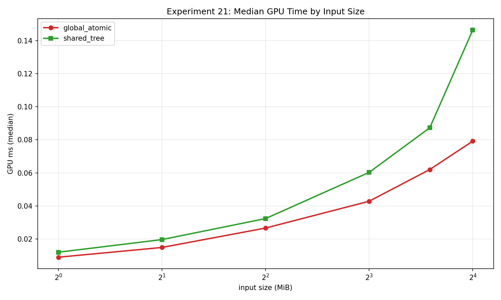
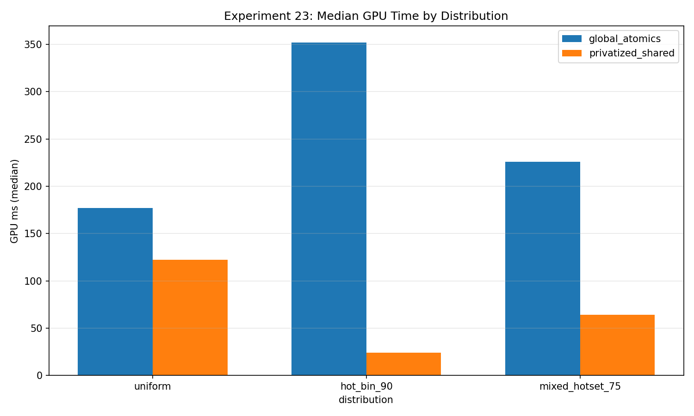
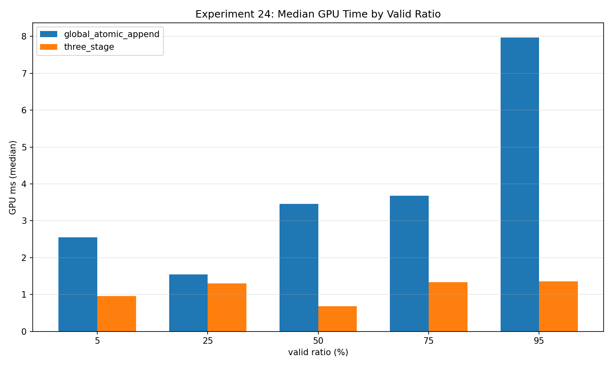

Parallel primitives turn memory access into something a renderer can use: totals, offsets, histograms, compact streams, and lists. They also make benchmark accounting more demanding. An implementation that writes a correct count may still produce the wrong order. A bandwidth formula can accidentally charge reads the shader never executes. Sorting inputs before a dispatch can improve its timing while moving substantial work outside the measurement.

This fifth part of my [GPU memory experiment series](/blog/gpu-memory-experiments-series/) follows those details through experiments 21–25. I use the `2026-10-23-integrity-fixes` snapshot on an RTX 2080 SUPER, driver 610.88, Vulkan 1.4.341. Every case has two warmups and five timed samples, with a **32 MiB total scratch budget** per experiment. All exported timed rows passed their correctness checks.

The medians below come directly from the raw rows. This is one exploratory collection on one GPU, not statistical proof of an architectural cause. In particular, fewer atomic operations or fewer dispatches do not automatically imply a shorter measured time.

## 21: reduction changes where communication happens

Experiment 21 sums the same deterministic integer stream in two ways. `global_atomic` adds each input to one global output word. `shared_tree` first accumulates lane-local contributions, reduces a 256-entry shared array through eight tree levels, and emits one global atomic per workgroup.

Both return the same uint32 sum. The harness rebuilds the CPU sum, resets the GPU output inside the timed reduction command sequence, reads the result back, and validates it for each measured iteration. Upload and readback have separate stage timings; the headline GPU value is the reduction stage, including its output reset.

At the largest common `N=4,194,303`, one compute dispatch, the median was **0.079200 ms** for `global_atomic` and **0.146432 ms** for `shared_tree`. Their exported logical-payload bandwidths were **211.833535** and **114.573427 GB/s** respectively.

That result is a reason to measure the complete implementation, not a reason to conclude that shared reduction is generally slower. The shared tree adds barriers and shared-memory work. Conversely, the reported GB/s numerator counts the logical input/output payload rather than the two strategies' different atomic communication. It cannot tell me how much physical DRAM traffic either implementation generated.

For an application, I would compare this single-dispatch design against a scalable multi-pass reduction and vary the number of elements accumulated by each invocation. The current result describes this dispatch shape and its final global accumulation.



[Experiment 21 raw rows](/assets/blog/gpu-memory-experiments-2026-10-23/data/21_parallel_reduction.json).

## 22: a full scan must carry block totals forward

Experiment 22 produces a full-array inclusive scan. The pipeline scans blocks, scans their totals, and adds the preceding blocks' totals back into the per-element results. Ping-pong shared arrays keep each scan step from reading partially updated values. Explicit compute dependencies separate the three dispatches.

The varied parameter is items per thread: 1, 2, 4, or 8, with 256 invocations per workgroup. Block sizes therefore grow from 256 to 2,048 elements. The CPU oracle computes the entire inclusive result using uint32 wrapping arithmetic and checks every output after each run.

At `N=786,432`, **three dispatches per logical scan**, medians were **1.261536 / 1.307456 / 1.254752 / 1.277248 ms** for items-per-thread 1/2/4/8. The four-item case exported **626,762,898.166 input elements/s**.

The important accounting choice is to divide one logical input length by the full pipeline time. Multiplying `N` by three because three dispatches ran would invent three scans. The differences between these medians are small enough that I would repeat and randomize collections before preferring one configuration. The block-total scan also has a bounded capacity; this is not an indefinitely recursive scan implementation.

[Experiment 22 raw rows](/assets/blog/gpu-memory-experiments-2026-10-23/data/22_prefix_sum_scan.json).

## 23: the distribution is part of an atomic workload

Experiment 23 builds a 256-bin histogram from uniformly distributed values, a 90%-hot-bin distribution, and a 75% hotset spanning eight bins. `global_atomics` updates the final histogram directly. `privatized_shared` builds a workgroup histogram, synchronizes its producers and consumers, and flushes only nonzero local bins to the global histogram.

Both paths consume the same input for a given distribution. A CPU histogram checks all 256 output counts after each measured dispatch, including the distributions where most updates concentrate on a small set of addresses.

At `N=8,388,352`, one dispatch:

| Distribution | Global atomics median ms | Privatized shared median ms |
|---|---:|---:|
| Uniform | 177.194048 | 122.185504 |
| 90% hot bin | 351.869824 | 23.921952 |
| 75% eight-bin hotset | 225.880544 | 64.332512 |

The hot-bin case is particularly interesting because privatization changes how often the final global counters are touched. I can say that these implementations respond differently to skew; I cannot infer a universal atomic latency or a hardware contention counter from elapsed time. The shared path introduces its own local contention and flush work, and the bandwidth metric is a model of requested operations, not an observed bus trace.

In practice, I would include several real content distributions in a histogram benchmark. A uniform synthetic stream can conceal precisely the hot counters that matter in a visibility or material-binning pass.



[Experiment 23 raw rows](/assets/blog/gpu-memory-experiments-2026-10-23/data/23_histogram_atomic_contention.json).

## 24: compaction has an ordering contract and a survivor count

Experiment 24 compares global atomic append with a three-stage flag-scan, block-prefix, and scatter pipeline. A deterministic predicate selects survivors at nominal keep ratios of 5%, 25%, 50%, 75%, and 95%.

The atomic path reserves output slots as invocations arrive, so its output is unordered. The staged path preserves input order. Validation respects that distinction: exact membership and length for unordered append, exact sequence and length for stable compaction. I would choose the required ordering contract before choosing an implementation for a production consumer.

At `N=786,432`, nominal 5% produced **39,307 survivors**. Atomic append used one dispatch and measured **2.545888 ms**; stable staged compaction used three and measured **0.952256 ms**. At nominal 50%, the corresponding medians were **3.452192 ms** and **0.683520 ms**. These are complete measured GPU paths, not just the final scatter.

The corrected traffic estimate follows the shader's actual paths. Discarded elements evaluate a predicate based on their index; they do not load the source value. With `N` inputs, `V` survivors, and `B` workgroups:

```text
atomic append: 16 * V bytes
staged path:   4 * (N + 4*V + 4*B + 1) bytes
```

The atomic model includes survivor input/output and an eight-byte modeled counter read-modify-write. The staged model includes per-element prefix writes, block counts/prefixes, the total count, and survivor-only scatter accesses. At 5%, the atomic estimate is **628,912 bytes**, not a full input read plus survivor traffic. These are source-level estimates, not measured DRAM bytes; input elements/s remains a separate useful-work metric.



[Experiment 24 raw rows](/assets/blog/gpu-memory-experiments-2026-10-23/data/24_stream_compaction.json).

## 25: coherent input helps a kernel, but sorting has a bill

The implemented capstone is a one-dimensional binning kernel, rather than a complete clustered-culling renderer. Each point contains an x coordinate and entity ID. The shader maps x to one of 64 bins, atomically reserves a slot, and writes the ID. Per-bin capacity equals the total entity count, preventing overflow at the cost of substantial list storage.

`global_append` receives the original records. `coherent_append` receives CPU-sorted records. They execute the same shader. Validation checks counts and compares sorted entity-ID membership inside every bin, allowing the atomic append order to vary.

At `N=126,976` entities, one dispatch, the original/coherent medians were **2.776000 / 0.280128 ms** for uniform sparse input, **2.348352 / 0.237632 ms** for uniform dense input, and **1.998560 / 0.230240 ms** for clustered input.

I read this as evidence that input order matters to this kernel. CPU sorting is outside its GPU timing, and the benchmark does not include downstream rendering savings. Before adopting sorting, I would measure preprocessing, determine how many dispatches reuse that order, and calculate the end-to-end break-even point. A lower dispatch time alone does not answer that question.

[Experiment 25 raw rows](/assets/blog/gpu-memory-experiments-2026-10-23/data/25_spatial_binning_clustered_culling_capstone.json).

The [summary CSV](/assets/blog/gpu-memory-experiments-2026-10-23/data/summary.csv) and [snapshot manifest](/assets/blog/gpu-memory-experiments-2026-10-23/data/manifest.json) preserve the collection context. The [repository](https://github.com/semihguresci/gpu-memory-access-benchmark) provides project background; this article's evidence is the corrected site snapshot, including work that was uncommitted when collected.

[Previous: tiling, live state, and barriers](/blog/gpu-memory-experiments-16-20-tiling-registers-and-barriers/) · [Next: alignment, heaps, and shared memory](/blog/gpu-memory-experiments-26-29-alignment-heaps-and-shared-memory/).
