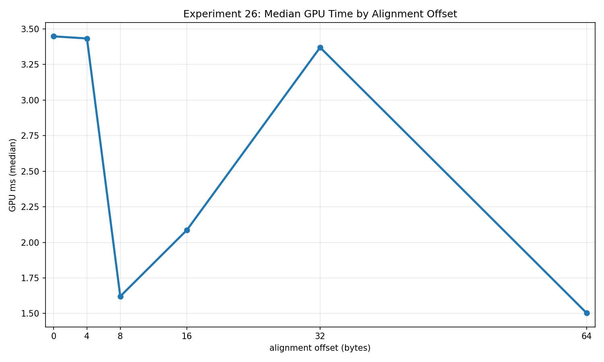
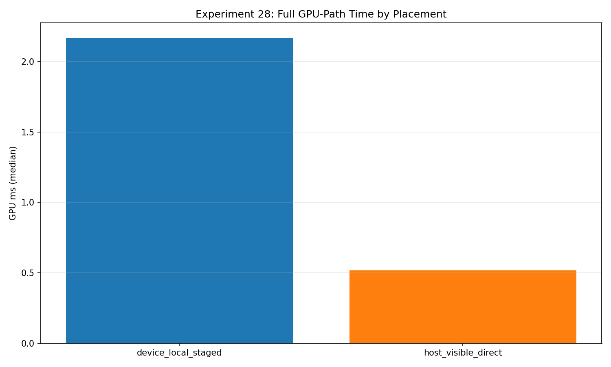
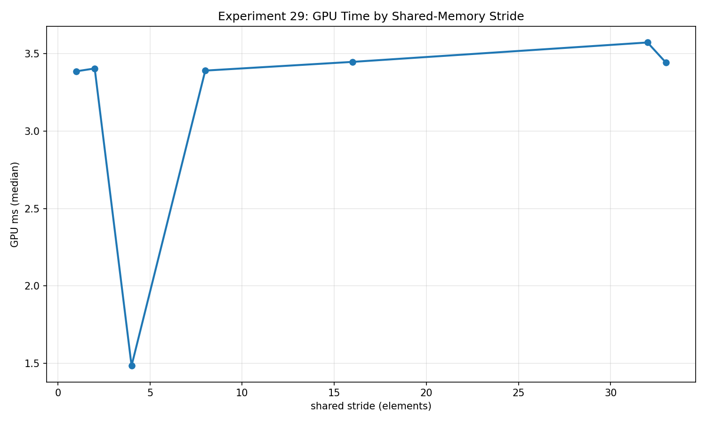

“Memory performance” can mean the shape of neighboring addresses, the order in which a working set is visited, the heap backing a buffer, or the arrangement of data inside a workgroup. I find it useful to put those questions beside one another because an apparently simple bandwidth result often combines several of them.

This sixth part of my [GPU memory experiment series](/blog/gpu-memory-experiments-series/) covers experiments 26–29. The source is the corrected `2026-10-23-integrity-fixes` collection: RTX 2080 SUPER, NVIDIA driver 610.88, Vulkan 1.4.341, five timed samples following two warmups. Each experiment used a **32 MiB total scratch budget**, with its logical count fitted to the resources it retains.

All timed rows passed their correctness checks. I recomputed the medians from those rows, keeping each stated problem size and dispatch count explicit. This remains a small exploratory collection on one GPU; the numbers are observations of particular implementations, not direct measurements of cache misses, bank conflicts, or physical bus bandwidth.

## 26: move the source base while keeping contiguous access

Experiment 26 shifts the input base by 0, 4, 8, 16, 32, or 64 bytes. Each invocation still loads one uint32 and writes one uint32 at a contiguous destination. The shader applies the same integer transform using the loaded value and logical index. Extra source space makes every shifted range valid.

The CPU reference uses the selected offset to compute every expected output. Each measured iteration checks the output and verifies that the source is unchanged. Workgroup size remains 256, and the logical count is common across offsets.

At `N=4,194,048`, one dispatch:

| Source offset | Median GPU ms | Useful payload GB/s |
|---|---:|---:|
| 0 bytes | 3.447712 | 9.731783 |
| 4 bytes | 3.432928 | 9.773693 |
| 8 bytes | 1.620768 | 20.701534 |
| 16 bytes | 2.086592 | 16.079993 |
| 32 bytes | 3.369888 | 9.956528 |
| 64 bytes | 1.503680 | 22.313514 |

The useful numerator is eight bytes per output: one four-byte load and one four-byte store. It does not count extra memory transactions that an implementation might request.

These medians do not support a simple monotonic misalignment penalty. In particular, the 64-byte offset is ahead of the unshifted case in this snapshot. I would repeat the collection with varied ordering and inspect transaction counters before explaining that difference. The offset also selects a different slice of the deterministic source; the access structure and transform remain the same, but the output values are checked with an offset-specific oracle.

The experiment's “warp-level” name should not be read as a portable promise about subgroup width. The recorded 32-lane grouping is an interpretation aid, not a rule that every Vulkan device executes workgroups that way. The next useful extension would vary actual access width and source/destination alignment independently.

[Experiment 26 raw rows](/assets/blog/gpu-memory-experiments-2026-10-23/data/26_warp_level_coalescing_alignment.json).

## 27: preserve the footprint and permute its visits

Experiment 27 uses an index buffer for every variant. Sequential mode stores the identity permutation. Block-shuffled mode reorders 32-element blocks but preserves order within a block. Random mode shuffles all indices. Each permutation visits the same source elements exactly once; even the sequential reference pays for reading its index.

The shader loads the index, loads the selected source value, computes a deterministic transform, and writes one output. That gives a requested payload of twelve bytes per logical element. The CPU checks the permutation buffer, source values, and every output after each timed run.

At `N=2,796,032`, one dispatch, sequential mode measured **4.301120 ms**, block-shuffled **4.276512 ms**, and random **11.090304 ms**. The source working set was **11,184,128 bytes**, distinct from the total budget containing source, indices, and output.

The near-equal sequential and block-shuffled medians suggest that this case tolerates reordering at that block granularity. I would not interpret their small difference as a ranking. The random case loses the same within-block structure, but timing alone does not identify how much of its change comes from coalescing, cache behavior, or scheduling.

This is a useful gather pattern comparison because the unique source footprint is held fixed. It is not a dependent pointer chase, a cache-capacity measurement, or proof that a specific cache “thrashes.” A follow-up could independently permute positions inside each block and the order of the blocks, then repeat at several working-set sizes.

[Experiment 27 raw rows](/assets/blog/gpu-memory-experiments-2026-10-23/data/27_cache_thrashing_random_vs_sequential.json).

## 28: the kernel and the data journey need separate timings

Experiment 28 executes the same transform directly on host-visible buffers or on device-local buffers with explicit upload and readback copies. The logical output is identical. Every timed iteration checks the full output against a common CPU reference and verifies the corresponding host-side source.

The corrected budgeting counts **six simultaneously live buffers**: direct input/output, staging input/output, and device input/output. At `N=1,398,016`, each payload spans **5,592,064 bytes**. All six total **33,552,384 bytes**, within the 33,554,432-byte budget. The direct path actively uses two buffers; the staged path uses four. These active sets are not substitutes for the full live-allocation count.

The export also records actual memory selection. Host and staging resources used **type 3, heap 1, flags 6**, meaning host-visible plus host-coherent. Device resources used **type 1, heap 0, flags 1**, meaning device-local. These properties describe the selected implementation, not a universal physical location inferred from the variant name. Vulkan distinguishes the properties in its [memory-property definition](https://docs.vulkan.org/refpages/latest/refpages/source/VkMemoryPropertyFlagBits.html); host visibility and device locality can coexist on other memory types.

At this size, with one compute dispatch, direct access had a median GPU path of **0.517760 ms**. The staged path's median was **2.166528 ms**. Its individual stage medians were:

| Staged operation | Median ms |
|---|---:|
| Upload | 1.072096 |
| Kernel | 0.025952 |
| Readback | 1.068224 |

The headline path value is the median of each iteration's upload-plus-kernel-plus-readback sum. Adding independently computed stage medians need not reproduce that median exactly. CPU submission gaps are outside the GPU sum; wall-clock timing includes them along with filling and validation.

The device-local kernel is short in this collection, but this one-upload/one-dispatch/one-readback path does not repay its copies. I would test upload once, run several consumers, and read back only the required result before deciding whether staging fits an application. Useful-payload GB/s here divides kernel payload by the whole GPU path time, so it is not a PCIe or DRAM bandwidth measurement. Allocation padding is recorded separately from the payload budget, and physical residency is not measured.

[Experiment 28 raw rows](/assets/blog/gpu-memory-experiments-2026-10-23/data/28_device_local_vs_host_visible_heap_placement.json).

## 29: shared-memory stride is a control, bank conflict is a hypothesis

Experiment 29 writes each lane's value at a shared-memory address separated by a configurable stride. After publication, every lane runs sixteen iterations reading neighboring logical lanes and updating an integer accumulator. Strides are 1, 2, 4, 8, 16, and 32 words; `padded_fix` uses 33.

Every variant performs the same logical reads and arithmetic and produces the same mathematical result. The CPU reproduces the workgroup data and accumulator, checking all outputs. Address spacing changes; the useful work does not.

All variants use the same shader declaration, `256 * 33` shared uint32 values: **33,792 bytes per workgroup**. A small active span in the stride-one case does not imply a smaller declared footprint. The runtime checks this requirement against the device's shared-memory limit before running the experiment.

At `N=4,194,304`, one dispatch, `stride_1` measured **3.386688 ms**, `stride_4` **1.484448 ms**, `stride_32` **3.572768 ms**, and `padded_fix` **3.442848 ms**. That result does not establish that padding universally helps, or that stride four is intrinsically preferable. The experiment changes source addresses while the driver chooses the machine instructions; it does not observe bank-conflict counters or prove a particular bank mapping.

For shared tiles in production, I would keep the correctness oracle, query resource limits, compare several legal padding choices, and inspect the compiled access pattern. I would also separate broadcast, access width, and active-lane count into their own controls. The name of a suspected bottleneck should not become the explanation before it is measured.

[Experiment 29 raw rows](/assets/blog/gpu-memory-experiments-2026-10-23/data/29_shared_memory_bank_conflict_study.json).

The [summary CSV](/assets/blog/gpu-memory-experiments-2026-10-23/data/summary.csv) and [snapshot manifest](/assets/blog/gpu-memory-experiments-2026-10-23/data/manifest.json) accompany this evidence. The [project repository](https://github.com/semihguresci/gpu-memory-access-benchmark) gives broader context; the linked site data preserves the corrected working-tree snapshot rather than assuming the public default branch has the same changes.

[Previous: reduction, scan, and compaction](/blog/gpu-memory-experiments-21-25-reduction-scan-and-compaction/) · [Next: subgroups, transpose, and radix sort](/blog/gpu-memory-experiments-30-34-subgroups-transpose-and-radix-sort/).
