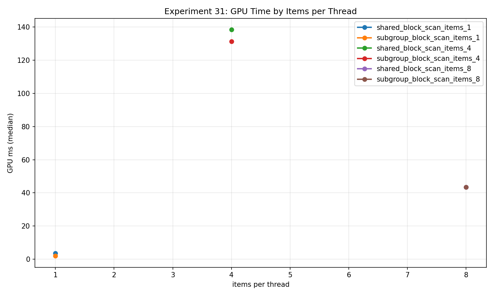
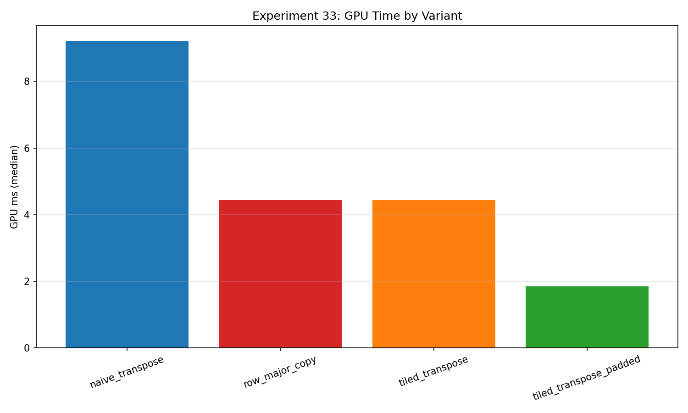
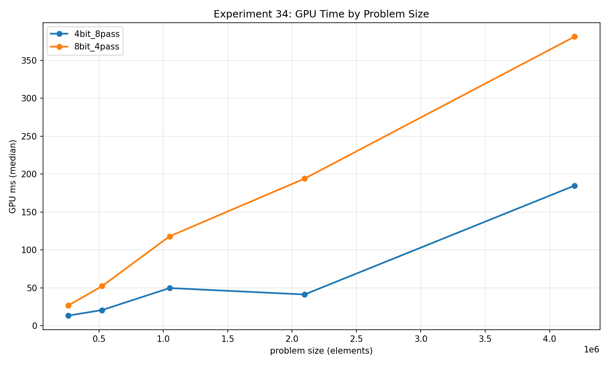

By this point in the series, I wanted to connect individual memory accesses to useful parallel primitives. A reduction needs communication, a scan needs ordering, compaction needs a precise output contract, and radix sort combines several of those decisions into a complete operation. These experiments made me pay more attention to what the benchmark actually promises.

The measurements below come from revision `2026-10-23-integrity-fixes`, on an NVIDIA GeForce RTX 2080 SUPER with driver 610.88 and Vulkan 1.4.341. Each case used two warmups and five timed samples. The total scratch budget was 32 MiB, except Experiment 34, which used 128 MiB. I report median GPU time; the CPU reference checks run outside GPU timing. Every exported row in these five experiments passed its correctness check. Validation layers were disabled for this performance collection.

The scratch budget does not mean every experiment processes the same number of elements. Buffers, counters, and intermediate representations consume different shares of it.

## 30: reducing communication without assuming a subgroup layout

[Experiment 30 raw data](/assets/blog/gpu-memory-experiments-2026-10-23/data/30_subgroup_reduction_variants.json)

Both variants sum the same integer input. The shared-tree path places one operand per invocation in shared memory and reduces the 256-entry workgroup array through explicit barriers. The hybrid path uses `subgroupAdd`, writes one partial per subgroup, and combines those partials before one final global atomic addition per workgroup.

At **2,621,440 elements and one dispatch**, the shared tree measured **2.166144 ms**, while the subgroup hybrid measured **1.382016 ms**. That is approximately a 1.57× timing ratio for this case. The CPU oracle checks the final sum after each timed execution.

The portability correction is small but consequential: the hybrid uses the actual `gl_NumSubgroups`, with storage for as many as 256 partials. Dividing workgroup size by subgroup size can miss partial subgroups, and a fixed array of 32 partials silently assumes a lower bound on subgroup width.

I would use this result to justify trying a subgroup-assisted reduction in a similar workload. I would still measure the complete reduction. The final global atomic is shared by both implementations and may become the dominant cost at another input size. The exported bandwidth counts input payload; it does not measure physical memory traffic or isolate the cost of the subgroup instruction.

## 31: scan makes logical ordering part of correctness

[Experiment 31 raw data](/assets/blog/gpu-memory-experiments-2026-10-23/data/31_subgroup_scan_variants.json)

Scan is less forgiving than sum. Addition can combine subgroup partials in any order, but an inclusive prefix must follow the input's logical sequence. Vulkan does not define a direct relationship between local invocation indices and subgroup invocation indices. I therefore cannot take data indexed by local ID and apply a subgroup prefix as though those orders necessarily agree. The [Khronos interface specification](https://docs.vulkan.org/spec/latest/chapters/interfaces.html) is the relevant portability contract.

The corrected subgroup shader counts active lanes, constructs dense logical positions in subgroup/lane order, and reads input through those positions. Subgroup prefixes and workgroup partial prefixes then describe the same sequence. Actual active counts also handle partial subgroups. The setup and its barriers remain inside the timed operation.

Both implementations perform **independent scans within workgroup blocks**. With 256 invocations, one, four, or eight items per invocation produces blocks of 256, 1,024, or 2,048 elements. There is no global prefix propagation between blocks. A CPU scan checks every output against the corresponding block boundary.

At **4,194,304 elements, one dispatch per sample**:

| Items per invocation | Shared scan, median ms | Subgroup scan, median ms |
|---:|---:|---:|
| 1 | 3.613024 | 1.969760 |
| 4 | 138.340960 | 131.192448 |
| 8 | 43.545728 | 43.504544 |



The one-item case benefits substantially here. Increasing items per invocation does not preserve that result. It also changes block size, per-invocation state, and the mapping of loads and stores. The large four-item cost is a finding that deserves compiled-code and transaction analysis; these five samples do not identify its mechanism. I would avoid treating the item-count sweep as an isolated subgroup comparison or a register-pressure measurement.

## 32: compaction needs a stability contract and an honest byte count

[Experiment 32 raw data](/assets/blog/gpu-memory-experiments-2026-10-23/data/32_subgroup_stream_compaction_variants.json)

This compaction also stops at workgroup boundaries. Each 256-element input block owns a fixed output segment. A predicate generated from the input index selects survivors, and each block exports its survivor count. Producing one globally contiguous stream would require another prefix-and-scatter step.

The shared-atomic variant appends survivors in an unspecified order. The subgroup-ballot variant assigns stable positions using the corrected logical mapping from Experiment 31. My oracle checks counts and all survivors, compares exact order for the stable path, and checks untouched segment tails. The two variants therefore have different ordering guarantees even when they produce the same set of values.

At **2,796,032 input elements and one dispatch**, the 5% case measured **1.369536 ms** for shared atomics and **0.927488 ms** for ballot ranking. At 50%, the medians were **2.199392 ms** and **1.110304 ms**. The ordering reversed at 75%: **1.003392 ms** for shared atomics versus **1.878816 ms** for ballot ranking. The snapshot does not support a universal ballot-wins rule.

Only surviving elements load the source payload. With `V` survivors and `B` blocks, the reported shader payload is:

```text
payload_bytes = 4 * (2 * V + B)
```

That covers survivor reads, survivor writes, and block-count writes. For the 5% case, `V = 139872` and `B = 10922`, giving **1,162,664 bytes**. Charging all input elements as source reads would inflate the bandwidth numerator. The metric still excludes shared operations and says nothing directly about DRAM transactions.

## 33: transpose exposes two different access directions

[Experiment 33 raw data](/assets/blog/gpu-memory-experiments-2026-10-23/data/33_two_dimensional_locality_transpose_study.json)

A row-major copy gives me a useful reference. A naive transpose reads one orientation and writes the other, making it difficult for neighboring invocations to issue contiguous accesses on both sides. A shared tile lets a workgroup load contiguous data, synchronize, and write the transposed tile through a different local mapping. The padded variant changes the shared array from 16×16 to 16×17.

For **4,194,304 elements, a 2,048×2,048 matrix, and one dispatch**, I measured:

| Variant | Median GPU ms |
|---|---:|
| Row-major copy | 4.442144 |
| Naive transpose | 9.213920 |
| Tiled transpose | 4.431040 |
| Padded tiled transpose | 1.842176 |



The host checks the complete destination against the appropriate copy or transpose reference. The requested payload is one four-byte read and one four-byte write per element.

Padding is clearly worth investigating on this configuration. Timing alone does not prove a particular bank mapping, however. The padded result also being faster than the copy reference is a reason to examine scheduling, generated code, and repeated-run variability before turning this into a hardware explanation. Rectangles, pitches, partial tiles, and image-backed storage remain separate questions.

## 34: count a complete sort as a complete sort

[Experiment 34 raw data](/assets/blog/gpu-memory-experiments-2026-10-23/data/34_radix_sort_gpu.json)

The final experiment compares least-significant-digit radix sorts with four-bit and eight-bit digits. Each digit pass has count, prefix, and stable scatter stages. Stability preserves the ordering established by earlier digit passes; the implementation ranks equal-digit keys consistently within blocks and combines block offsets in input order.

The four-bit configuration needs eight passes and **24 dispatches**. The eight-bit configuration needs four passes and **12 dispatches**. Both are timed as one complete logical sort, with CPU sorting used to check every final key. This is key-only sorting: there is no associated payload array whose order I can inspect separately.

At **4,194,304 keys**, the four-bit path measured **184.684992 ms**, compared with **381.079264 ms** for eight-bit digits. Their logical rates were approximately **22.71 million** and **11.01 million keys/s**. Fewer dispatches did not produce the faster implementation in this collection.



Radix width also changes histogram size, prefix work, and auxiliary traffic. I cannot explain the result by dispatch count alone. The bandwidth model includes estimated global accesses, while keys/s counts each logical key once per completed sort. Multiplying that rate by 12 or 24 would reward internal staging rather than useful work.

For me, the common lesson is that the primitive's contract comes first: reduction needs a sum, scan needs a defined sequence, compaction needs an ordering policy, and sorting needs every pass. Optimizing communication only helps when those promises survive.

The [snapshot summary](/assets/blog/gpu-memory-experiments-2026-10-23/data/summary.csv) and [provenance manifest](/assets/blog/gpu-memory-experiments-2026-10-23/data/manifest.json) accompany the raw files. The [public project](https://github.com/semihguresci/gpu-memory-access-benchmark) provides context; this attached snapshot records a corrected working tree and should not be assumed identical to the repository's current default branch.

[Series overview](/blog/gpu-memory-experiments-series/) · [Previous: alignment, heaps, and shared memory](/blog/gpu-memory-experiments-26-29-alignment-heaps-and-shared-memory/) · [Next: occupancy and rendering data](/blog/gpu-memory-experiments-35-39-occupancy-and-rendering-data/)
