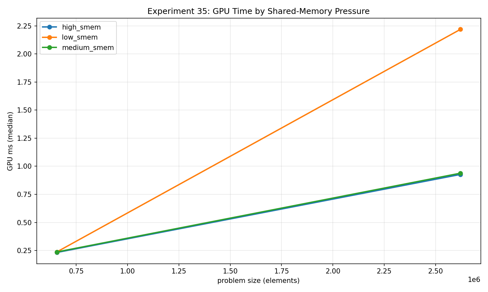
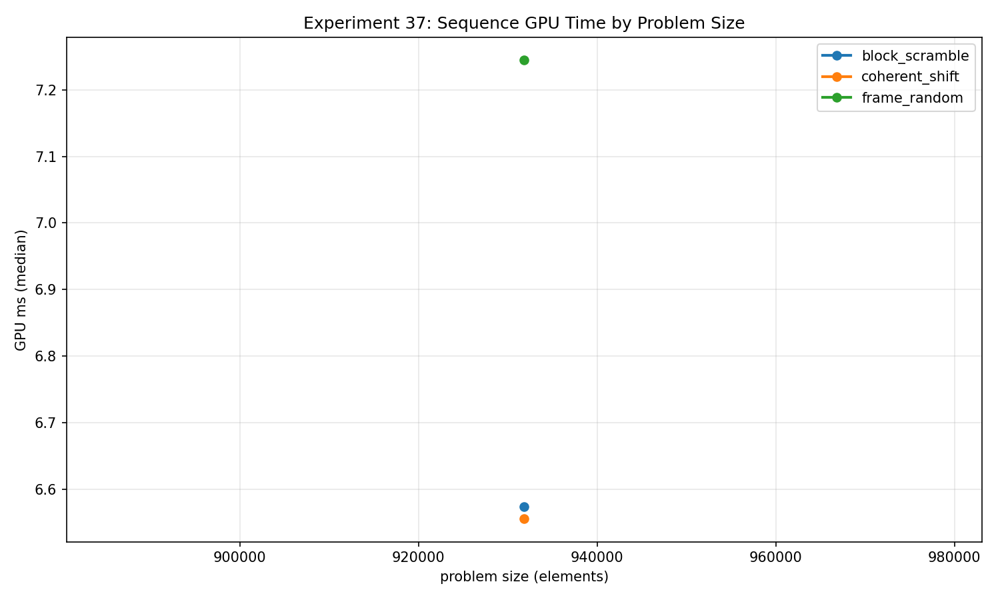
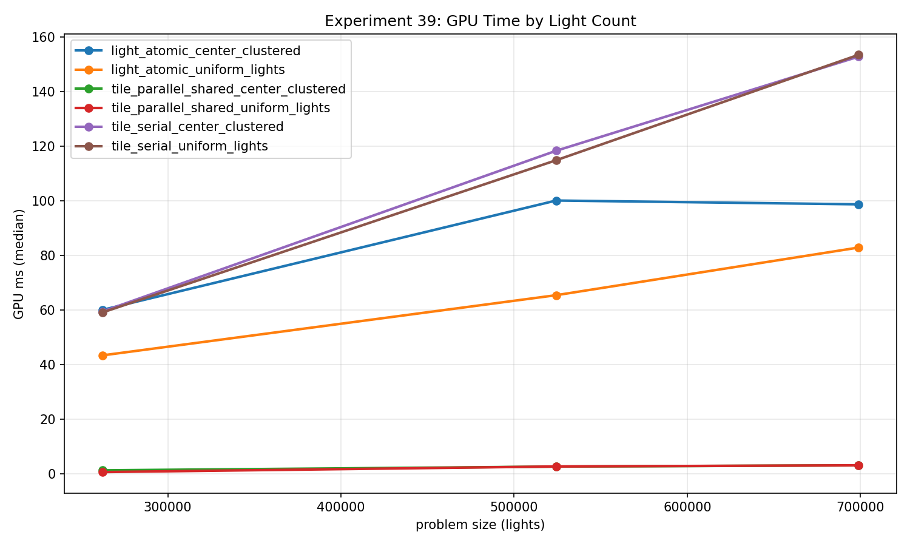

These five experiments move toward problems I encounter in rendering: resource pressure, node storage, data reused across frames, visibility lists, and light-to-tile assignment. I find them useful because they expose interactions that a streaming copy cannot. Their names also need careful reading. A node checksum is a layout probe, and an occupancy proxy needs more evidence before it becomes an occupancy measurement.

This snapshot uses revision `2026-10-23-integrity-fixes`, an NVIDIA GeForce RTX 2080 SUPER, driver 610.88, and Vulkan 1.4.341. Every experiment used a **32 MiB total scratch budget**, two warmups, and five timed iterations per case. Times below are GPU medians. All exported correctness checks passed; validation layers were disabled during collection. The CPU validation work is outside the GPU timestamp interval.

## 35: declared shared memory is a hypothesis about occupancy

[Experiment 35 raw data](/assets/blog/gpu-memory-experiments-2026-10-23/data/35_occupancy_modeling.json)

I keep the useful computation fixed: 256 invocations load one integer each into shared memory, synchronize, combine a local value with its rotated neighbor, and write one integer each. The three shaders declare shared arrays of **1 KiB, 8 KiB, and 32 KiB**. Only the first 256 entries participate in the transform. The CPU reference reproduces that transform and checks every output after each measured dispatch.

At **2,621,440 elements and one dispatch**:

| Shared-memory declaration | Median GPU ms |
|---|---:|
| 1 KiB | 2.219040 |
| 8 KiB | 0.938624 |
| 32 KiB | 0.927168 |

The larger declarations were faster in this collection. I cannot turn that into “lower occupancy is better.” I first need to know what shared allocation survived compilation, how many workgroups were resident, and what limited execution. Source-level array size is only one input to that investigation. In particular, a compiler can see that much of the declared array is never indexed.

The practical result is a shortlist for inspection, not an occupancy curve. I would compare compiled resources and hardware counters before connecting the timing to residency. The common payload metric counts one four-byte load and one four-byte store per element, while the shared-memory declaration is recorded separately. Devices unable to support the largest workgroup resource requirement are rejected explicitly.

## 36: a node-shaped record is still a flat access experiment

[Experiment 36 raw data](/assets/blog/gpu-memory-experiments-2026-10-23/data/36_bvh_node_layout.json)

This kernel reads eight active integer words and folds them into an observable checksum for each logical node. Compact records use 32 bytes of storage. The padded representation occupies 64 bytes, with active words at spaced offsets. A third variant hashes the source-node index while retaining the compact representation.

At **174,592 logical nodes, one dispatch**, compact sequential reads measured **1.074976 ms**, compact hashed reads **1.427008 ms**, and padded sequential reads **2.651808 ms**. Every output checksum is compared against a CPU reference for its representation and address mapping.

This tells me that layout and index generation matter for this flat workload. There is no parent-to-child dependency, traversal stack, ray-box test, or changing path length. Each invocation can calculate its source address independently. Hashed addressing can revisit nodes, so it also changes the unique footprint rather than providing a guaranteed permutation of all records.

The useful payload is eight four-byte reads plus a four-byte checksum: **36 bytes per logical node**. That does not make a padded record 36 bytes long, nor does it mean the bus moved exactly 36 bytes. I would use the experiment to choose representations for a real BVH follow-up, then hold topology and rays fixed and measure dependent traversal separately.

## 37: every measured frame needs evidence

[Experiment 37 raw data](/assets/blog/gpu-memory-experiments-2026-10-23/data/37_frame_to_frame_coherence.json)

The frame experiment performs eight read/transform/write dispatches. Coherent mode shifts source indices by 17 elements per frame. Block mode rotates lanes inside 32-element blocks. Random mode hashes the invocation and frame indices. Each mode runs the same integer transform and writes the same number of results.

The corrected version preserves **eight disjoint output ranges**. I build a CPU reference for every frame and compare all eight ranges after each timed sequence. Initializing outputs to the complement of their expected values makes a missed write detectable. Seven compute barriers deliberately order the frames, and their cost is included in sequence timing.

At **931,840 elements per frame and eight dispatches**, coherent shifts measured **6.555424 ms**, block scrambling **6.573280 ms**, and frame-random mapping **7.244576 ms**.

Preserving the oracle changes the memory budget. The source occupies **3,727,360 bytes** and the eight outputs occupy **29,818,880 bytes**: **33,546,240 bytes** of live buffer payload within the 33,554,432-byte budget. Allocation bytes, active spans, and the original total budget have separate note fields. This collection selected host-visible, host-coherent memory for these buffers; that information belongs alongside any performance interpretation.

The payload numerator is `N * 8 frames * 8 bytes`, and throughput counts all eight frames. These are requested accesses. The modes also change spatial coalescing and source collisions, so the timing difference does not isolate temporal reuse. A more controlled follow-up would preserve the within-frame permutation and vary only what happens between frames.

## 38: adding cluster counters is additional work

[Experiment 38 raw data](/assets/blog/gpu-memory-experiments-2026-10-23/data/38_frustum_vs_clustered_culling.json)

Both paths test generated positions against the same simple visibility predicate and append surviving entity IDs through a global counter. The mode called `clustered_culling` additionally increments a depth-cluster counter for each visible entity, using 16 clusters. It does not reject whole clusters before testing their members.

For **698,880 entities and one dispatch**, the wide-scene case measured **1.722080 ms** for direct visibility append and **17.952160 ms** with cluster counts. For the center-clustered distribution, the medians were **2.593952 ms** and **16.694752 ms**.

The oracle checks the visible count, the complete unordered set of emitted IDs, cluster counts where applicable, and untouched output tails. Sorting the readback IDs on the CPU lets me validate membership without pretending atomic append has stable ordering.

I also keep the generated-input limitation visible. The wide-scene variants use different generated samples: the direct case retained **402,678 entities**, while the clustered case retained **403,064**. These are comparable distributions, not perfectly paired input streams. Combined with the extra atomic work, that limits any causal statement about the mode itself.

I read the result as the cost of this append-plus-count proxy. A production clustered renderer might recover that cost through later rejection or more efficient shading, neither of which is present here. The byte model includes the requested counter operations and should not be interpreted as observed physical traffic.

## 39: remove the observer before measuring contention

[Experiment 39 raw data](/assets/blog/gpu-memory-experiments-2026-10-23/data/39_tiled_light_assignment.json)

The three assignment strategies produce the same 16×16 tile-count grid. The light-centric path computes a candidate rectangle, performs exact circle/tile overlap tests, and atomically increments useful tile counters. Tile-serial assigns one invocation to each tile and scans the entire light list. Tile-parallel assigns one workgroup to each tile, distributes the scan across its lanes, and reduces partial counts through shared memory.

I removed an observer that distorted the first strategy: every overlap previously incremented one global statistics word. The corrected shader has no statistics atomics. The host derives total overlaps from the measured tile counters after timing and validates every tile against the CPU overlap oracle. A mode echo provides a separate dispatch sanity check.

For **698,880 uniformly distributed lights and one dispatch**:

| Assignment strategy | Median GPU ms |
|---|---:|
| Light-centric atomic | 82.812992 |
| Tile-serial | 153.363520 |
| Tile-parallel shared | 3.086688 |

This is an algorithm comparison. The light-centric path examines a candidate subset; both tile-centric paths scan every light for every tile. Their arithmetic and requested reads differ substantially. The parallel result's approximately **927.41 modeled GB/s** comes from counting repeated light reads across tiles. It is not a measurement of external memory bandwidth. The model treats each useful tile atomic as a four-byte read plus a four-byte write and records that assumption explicitly.

I would take the parallel tile scan seriously as an implementation candidate for this input size. I would also test different tile counts, light radii, memory placement, and downstream list construction before making a rendering recommendation. Here, counts are the final product; allocation of complete light lists is still future work.

The [aggregate snapshot](/assets/blog/gpu-memory-experiments-2026-10-23/data/summary.csv) and [manifest](/assets/blog/gpu-memory-experiments-2026-10-23/data/manifest.json) record the evidence behind these comparisons. Five samples on one device establish a measured snapshot, not statistical significance or a portable performance ranking.

[Series overview](/blog/gpu-memory-experiments-series/) · [Previous: subgroups, transpose, and radix sort](/blog/gpu-memory-experiments-30-34-subgroups-transpose-and-radix-sort/) · [Next: queues, fusion, and reproducibility](/blog/gpu-memory-experiments-40-45-queues-fusion-and-reproducibility/)
