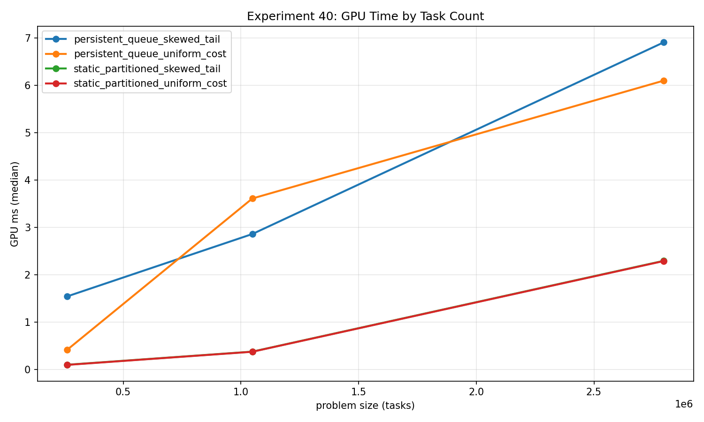
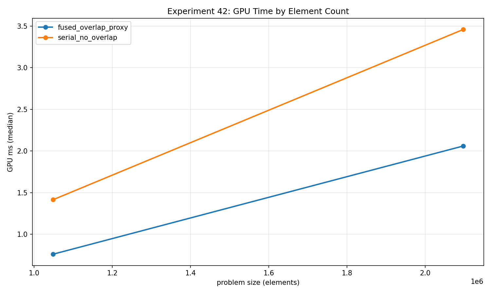
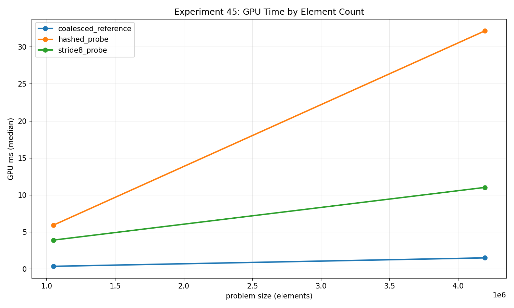

The final group of experiments asks how memory decisions interact with scheduling and pipeline composition. I wanted to test whether a shared work queue pays for itself, whether subgroup helpers improve a complete primitive, and whether fewer dispatches necessarily produce a faster pipeline. The results give me several counterexamples to simple optimization rules.

All numbers here come from `2026-10-23-integrity-fixes`, collected on an NVIDIA GeForce RTX 2080 SUPER with driver 610.88 and Vulkan 1.4.341. Each case used a **32 MiB total scratch budget**, two warmups, and five timed samples. I quote median GPU time and state the logical problem size and actual dispatch count. All exported correctness checks passed. CPU references run outside GPU timing, and validation layers were disabled for the performance collection.

## 40: a work queue has a price per claim

[Experiment 40 raw data](/assets/blog/gpu-memory-experiments-2026-10-23/data/40_persistent_threads_work_queues.json)

The static path gives one invocation one task. The persistent path launches **32,768 workers**; each worker atomically claims one task index, executes its integer loop, writes a per-task checksum, and claims again. Workers perform another claim when discovering that the queue is exhausted. Claim granularity is one task, with a single shared global cursor.

At **2,796,032 tasks and one dispatch per sample**:

| Task distribution | Static, median ms | Persistent queue, median ms |
|---|---:|---:|
| Uniform-cost family | 2.290240 | 6.098912 |
| Skewed-tail family | 2.295232 | 6.906784 |



The CPU oracle computes every task's expected checksum from its index and loop count. The comparison covers the entire output, rather than inferring completion from the queue cursor alone.

These inputs do not repay this queue's overhead. That observation combines several choices: one atomic per task claim, a fixed worker population, and different launch geometry from static partitioning. The variants draw from the same cost distributions but have separately generated samples. For example, the skewed-tail means are approximately **52.54** and **52.52 iterations per task**. They are close, but the comparison is not a paired replay of exactly the same cost array.

I would next vary claim chunk size and task duration independently, while reusing an identical task list across strategies. Chunking could amortize atomics but worsen load balance. The exported bandwidth also includes a queue-operation estimate for the persistent path, so its GB/s is not directly comparable to static useful-payload bandwidth as a measure of bus utilization.

## 41: measure the aggregate promised to the caller

[Experiment 41 raw data](/assets/blog/gpu-memory-experiments-2026-10-23/data/41_subgroup_operations_study.json)

Both implementations return a workgroup-wide result to every invocation:

```text
result = uint32_sum(all workgroup inputs) + 17 * count(odd inputs)
```

The shared baseline reduces two 256-entry arrays. The subgroup path uses an arithmetic sum and ballot count within each subgroup, then combines the actual subgroup partials through shared memory. The result depends on workgroup membership, not on any assumed relationship between local indices and subgroup lanes. Out-of-range inputs contribute zero, and unsigned sums wrap consistently in the shader and CPU oracle.

At **4,194,304 elements and one dispatch**, the shared baseline measured **2.062016 ms**, while subgroup intrinsics measured **3.441984 ms**. The recorded subgroup size was 32. I compare every output with an independent CPU workgroup aggregate after each measured run, first initializing outputs to values that differ from the expected result.

This result is compatible with the hybrid reduction improvement in Experiment 30 because the complete operations differ. Here, a serial combination of subgroup partials, shared-memory communication, barriers, and a result broadcast all belong to the primitive being measured. I cannot read the difference as the latency of `subgroupAdd` or ballot instructions. The common payload is eight bytes per element, excluding internal shared-memory work.

## 42: this is serial versus fused execution on one queue

[Experiment 42 raw data](/assets/blog/gpu-memory-experiments-2026-10-23/data/42_async_compute_overlap.json)

The experiment's original name mentions asynchronous compute, but the implementation compares **two serial dispatches with one fused dispatch on the same queue**. Pass A transforms one input stream; pass B independently transforms another. The fused shader executes both transforms and materializes both output arrays in one invocation.

For **2,097,152 logical elements**, serial execution measured **3.457472 ms across two dispatches**. Fused execution measured **2.059648 ms across one dispatch**. Both consume two four-byte inputs and produce two four-byte outputs per logical element. The oracle validates both complete output streams. Logical throughput counts `N`, not `2N`, because each reported operation includes both transforms.



This is evidence about dispatch composition and scheduling for this pair of kernels. There are no concurrent queues, semaphore fan-out/join, or measurements of overlap between independent submissions. To study actual asynchronous execution, I would need to expose available queues, run identical independent workloads concurrently, and verify overlap with a trace. A faster fused shader cannot answer that question.

## 43: layout preferences change with the access stream

[Experiment 43 raw data](/assets/blog/gpu-memory-experiments-2026-10-23/data/43_ray_friendly_memory_layouts.json)

Each invocation reads eight active words for one logical primitive and folds them into a deterministic checksum. The AoS representation has a 64-byte record stride. The SoA representation stores the eight fields in separate contiguous planes, using 32 active bytes per primitive. Each is tested with sequential and hashed source indices.

At **174,592 primitives and one dispatch**:

| Layout and access | Median GPU ms |
|---|---:|
| AoS, sequential | 1.342016 |
| SoA, sequential | 0.427168 |
| AoS, hashed | 0.904992 |
| SoA, hashed | 2.652288 |

I validate every checksum against the corresponding CPU address mapping and transform. The sequential result makes SoA attractive for field-wise reads here, while the hashed result favors AoS in this collection. That reversal is more useful to me than a blanket claim that either layout is faster.

The experiment changes storage footprint as well as layout, and hashing can revisit source records. It therefore does not hold unique footprint constant. Despite the ray-oriented name, there are no rays, intersections, traversal dependencies, or hit results. Applying the finding to a renderer requires another experiment with fixed geometry and queries, including the cost of repacking or reordering data.

## 44: fusion does not guarantee a faster pipeline

[Experiment 44 raw data](/assets/blog/gpu-memory-experiments-2026-10-23/data/44_gpu_driven_pipeline_blocks.json)

This proxy classifies visibility, assigns one of 64 buckets, and emits a token. The staged path uses three dispatches with explicit dependencies. The fused path computes all stages in one dispatch. Both still write visibility and bucket arrays, making the intermediate results observable and comparable; fusion reduces intermediate reads and repeated input reads rather than removing every intermediate store.

At **2,097,152 elements**, the staged path measured **42.963392 ms across three dispatches**, compared with **49.800416 ms for one fused dispatch**. Visibility uses a hash-based threshold of 650 out of 1,000 possible values. The CPU reference checks all visibility flags, bucket values, and final tokens after each timed execution.

The common reported bandwidth numerator counts useful input and final output, **eight bytes per element**. Separate row notes estimate the larger internal traffic. This distinction matters: a logical-payload metric makes the final task comparable but does not account for all traffic caused by staging.

I would inspect generated code and repeat this comparison before explaining why the fused version loses. Pipeline shape, branches, and resource use all need evidence. The current workload does not compact a visible stream, generate indirect draw arguments, or submit rendering work. Its result is about these materialized transforms, not the performance of a complete GPU-driven renderer.

## 45: establish a reproducible signature before claiming portability

[Experiment 45 raw data](/assets/blog/gpu-memory-experiments-2026-10-23/data/45_cross_gpu_reproducibility.json)

The last experiment uses deterministic input, mapping seeds, integer transforms, full CPU output checks, and an exported checksum. It provides three access modes: contiguous indexing, stride-eight indexing modulo `N`, and hashed indexing modulo `N`.

At **4,194,304 elements and one dispatch**, the contiguous reference measured **1.517632 ms**, stride-eight **11.026688 ms**, and hashed access **32.160672 ms**. The raw files retain each iteration and its configuration, so another device can reproduce the same mapping and compare both correctness and performance.



The addressing modes do not visit an equal number of unique source elements. At this power-of-two size, stride eight reaches only **524,288 distinct indices**, repeating that subset eight times. Hashing also permits collisions and adds index-generation arithmetic. All paths request one source value per invocation, but requested bytes do not describe cache residency or physical traffic.

I have one GPU and one driver in this collection. The experiment establishes an auditable starting signature, not a cross-GPU ranking. A useful extension would collect the same revision on additional devices, preserve device and allocation metadata, and compare repeated independent runs. Correctness checksums would help detect accidental input or implementation drift before I compared timings.

The [aggregate summary](/assets/blog/gpu-memory-experiments-2026-10-23/data/summary.csv) and [provenance manifest](/assets/blog/gpu-memory-experiments-2026-10-23/data/manifest.json) accompany this snapshot. These results leave me with concrete follow-ups: coarser queue claims, paired input streams, actual queue overlap, equal-footprint layout controls, and a second GPU. Each would answer a more specific question than the experiment name alone.

[Series overview](/blog/gpu-memory-experiments-series/) · [Previous: occupancy and rendering data](/blog/gpu-memory-experiments-35-39-occupancy-and-rendering-data/)
